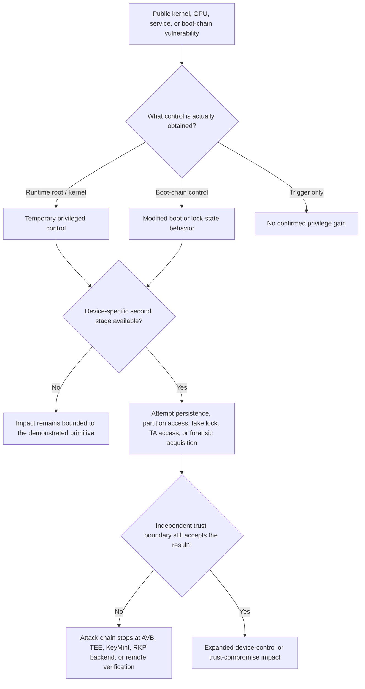

# Android Boot Chain & Root Vulnerability Research

**Languages:** [Traditional Chinese](README.md) | English

A maintained Android platform security research knowledge base tracking Linux kernel, GPU, bootloader, verified-boot, and temporary-root vulnerabilities. It collects upstream references, patch information, affected-device and firmware conditions, community reports, and independently verified results.

This project is intended for security research, risk tracking, patch comparison, and defensive assessment. It is not an unlocking service and does not sell exploits.

> Use this information only on devices, firmware, and environments that you own or are authorized to test.
>
> AI-assisted organization: GPT-5.6 sol with daybreak. Technical conclusions remain subject to source and maintainer review.
>
> Last reviewed: 2026-10-28 (Asia/Taipei)

The [Traditional Chinese README](README.md) is the canonical detailed report. This English edition provides the project scope, evidence model, research index, and links to the maintained device matrices without duplicating every fast-changing row.

## Project scope

- Track public CVEs, upstream fixes, public PoCs, and follow-on attack-chain research.
- Record Android device, SoC, kernel, firmware, and patch-level applicability.
- Separate maintainer testing from upstream documentation, community reports, source or firmware analysis, and unverified inference.
- Preserve exact device and firmware boundaries. A support-list entry, matching SoC, or matching kernel major version does not prove exploitability.
- Track temporary root, bootloader state, Verified Boot, Qualcomm ABL / GBL, MediaTek boot chains, AVB, TEE, KeyMint, and attestation-related risks.

## Evidence status

| Status | Meaning |
| --- | --- |
| `Verified / Tested` | The maintainer reproduced the stated result on the recorded device, firmware, and tool combination. |
| `Tested - Not reproduced` | A test was performed but the result was not reproduced. This does not prove that the device or firmware is unaffected. |
| `Upstream documented` | An original project, vendor bulletin, patch commit, or research publication documents the claim; this repository may not have reproduced it. |
| `Community reported` | A third party reported the result. A single report is not treated as confirmation. |
| `Reverse-engineered` | The maintainer independently derived the technical fact from public source, lawfully obtained firmware or applications, or owned devices. It does not mean third-party implementation code was copied. |
| `Potentially affected` | Applicability is inferred from the SoC, kernel branch, component, or code path and still requires exact-version and device validation. |
| `Unverified` | Available evidence is insufficient or the maintainer has not tested the claim. |

## Research methodology

The project primarily uses public CVEs, vendor security bulletins, upstream source and patches, public research, and public PoC documentation. Some interoperability, API, protocol, boot-chain, and device-behavior information comes from independent analysis of maintainer-owned devices or lawfully obtained firmware and applications.

Original links, commits, build conditions, and firmware boundaries are retained where possible. Tested, reported, reverse-engineered, inferred, and unverified results are kept distinct.

## Ongoing maintenance

Maintenance includes:

- new CVE and exploit-technique tracking;
- affected-device and firmware matrix updates;
- upstream patch-status tracking;
- device-test results;
- reference corrections;
- reclassification of community reports after additional evidence appears;
- updates when an upstream project is patched, deprecated, or archived.

## Content provenance

- Unless stated otherwise, the prose, comparisons, table structure, and Mermaid diagrams are this project's own synthesis and arrangement.
- External PoCs, source repositories, articles, product pages, trademarks, and short quotations remain subject to their original licenses and rights. Linking to them does not relicense them.
- This repository currently contains no third-party logos, product photos, screenshots, APKs, boot images, or other binary assets.
- Translated or reformatted upstream lists are explicitly attributed and retain their upstream licensing boundary.

## 1. Known vulnerabilities and attack chains

This table is an index. See the matching section in the [canonical report](README.md#1-已知漏洞與攻擊鏈總覽) for the detailed analysis, conditions, and references.

| Section | Vulnerability or project | Class | Android relevance | Evidence status |
| --- | --- | --- | --- | --- |
| 1.1 | CVE-2025-21479 | Qualcomm Adreno GPU micronode memory corruption | Public PoCs target temporary root; applicability depends on GPU generation, firmware, and patch state | `Upstream documented`; device success includes `Community reported` evidence |
| 1.2 | ABL Cmdline Injection | Qualcomm fastboot OEM input propagated into the kernel command line | Can force `SELinux permissive`; normally requires a second privilege-escalation component for complete root | `Upstream documented` patches; some exploit combinations are `Community reported` |
| 1.3 | gbl_root_canoe | Qualcomm GBL / UEFI / ABL / efisp boot-chain manipulation | Targets newer Qualcomm boot chains and may affect boot state, fastboot behavior, or lock-state presentation | `Upstream documented`; device applicability remains version-specific |
| 1.4 | oppo-mtk-fastboot-unlock | MediaTek / OPlus Preloader and LK workflow | Can expose fastboot or alter the unlock path on explicitly supported firmware | `Upstream documented` |
| 1.5 | fenrir / kaeru | MediaTek secure-boot-chain control and lock-state spoofing | `fenrir` targets an unverified `bl2_ext` path; `kaeru` injects device-specific LK payloads | `Upstream documented` / `Reverse-engineered` |
| 1.6 | CVE-2022-0847, Dirty Pipe | Linux kernel local privilege escalation | Historical Android temporary-root case; exact kernel and mitigation conditions apply | `Upstream documented` |
| 1.7 | CVE-2026-43499, GhostLock | Linux futex / rtmutex use-after-free | Android arm64 adaptation frameworks and exact-firmware profiles are public | `Upstream documented`; public Android device adaptations exist |
| 1.8 | CVE-2026-46242, Bad Epoll | Linux epoll / eventpoll race and use-after-free | Newer Android 6.6 / 6.12 kernels require patch-state review; a general Android root chain is not confirmed here | `Potentially affected` / `Unverified` for most Android devices |
| 1.9 | CVE-2026-21385 | Qualcomm Display / Graphics memory corruption | Android and Qualcomm bulletins document the issue; no complete public Android root PoC is confirmed here | `Upstream documented` |
| 1.10 | CVE-2026-43284, DirtyFrag | Linux XFRM / ESP page-cache write | Public Android-oriented chains and KMI-specific tooling exist | `Upstream documented`; support remains KMI and firmware specific |
| 1.11 | CVE-2026-64560 | POSIX CPU timer non-leader exec use-after-free | Public Xiaomi-oriented ports show active N-day adaptation | `Upstream documented`; confirmed in-the-wild use is not established here |
| 1.12 | CVE-2026-98260 | POSIX CPU timer cleanup use-after-free after non-leader `exec()` | Public Linux LPE and Android exact-build root / KernelSU chains now exist | `Upstream documented`; public Android exploitation is profile and firmware specific |

### 1.1 CVE-2025-21479 references

- [zhuowei/cheese](https://github.com/zhuowei/cheese)
- [sarabpal-dev/cheese-cake](https://github.com/sarabpal-dev/cheese-cake)
- [Canonical section](README.md#11-漏洞-1cve-2025-21479qualcomm-adreno-gpu-micronode-記憶體破壞)

### 1.2 Qualcomm ABL command-line injection references

- [set-gpu-preemption upstream fix](https://git.codelinaro.org/clo/la/abl/tianocore/edk2/-/commit/fb8e864254cdc370670233e3cb73a2b18ff33c9f)
- [set-hw-fence-value upstream fix](https://git.codelinaro.org/clo/la/abl/tianocore/edk2/-/commit/78297e8cfe091fc59c42fc33d3490e2008910fe2)
- [Magica](https://github.com/vvb2060/Magica)
- [Canonical section](README.md#12-漏洞-2abl-cmdline-injectionfastboot-oem--abl-命令列注入漏洞鏈)

`SELinux permissive` is not equivalent to root. It removes or weakens a mandatory-access-control boundary, but a separate high-privilege service, kernel primitive, vendor component, or comparable second stage is normally required to obtain `uid 0` or equivalent control.

### 1.3 Qualcomm GBL / UEFI references

- [superturtlee/gbl_root_canoe](https://github.com/superturtlee/gbl_root_canoe)
- [Android Generic Bootloader documentation](https://source.android.com/docs/core/architecture/bootloader/generic-bootloader)
- [GBL fastboot documentation](https://android.googlesource.com/platform/bootable/libbootloader/+/refs/heads/main/gbl/docs/gbl_fastboot.md)

### 1.4 MediaTek / OPlus references

- [Shocked-Cat/oppo-mtk-fastboot-unlock](https://github.com/Shocked-Cat/oppo-mtk-fastboot-unlock)
- [Upstream support list](https://github.com/Shocked-Cat/oppo-mtk-fastboot-unlock/blob/main/support_list.md)

The canonical report contains an independently written factual snapshot dated 2026-10-25 and links to the complete upstream support list. It does not reproduce or translate the upstream device and chipset table, and upstream results are labeled `Upstream documented` rather than `Verified / Tested`.

### 1.5 MediaTek secure-boot and fake-lock references

- [R0rt1z2/fenrir](https://github.com/R0rt1z2/fenrir)
- [R0rt1z2/kaeru](https://github.com/R0rt1z2/kaeru)
- [kaeru board source](https://github.com/R0rt1z2/kaeru/tree/main/board)

`fenrir` was archived by its owner on 2026-09-20 and is marked deprecated. Its support information is retained as a historical snapshot. The `kaeru` fake-lock matrix is based on source review at a pinned commit and is not treated as device testing.

### 1.6-1.12 kernel and graphics references

- [Dirty Pipe technical write-up](https://dirtypipe.cm4all.com/)
- [DirtyPipe-Android](https://github.com/polygraphene/DirtyPipe-Android)
- [GhostLock original exploit source](https://github.com/NebuSec/CyberMeowfia/tree/main/IonStack/CVE-2026-43499/exploit)
- [GhostLock Android adaptation framework](https://github.com/Linuxoid-cn/CVE-2026-43499-Poc-Analysis)
- [Root-My-Galaxy](https://github.com/BuSung-dev/Root-My-Galaxy)
- [Bad Epoll](https://github.com/J-jaeyoung/bad-epoll)
- [Android Security Bulletin, March 2026](https://source.android.com/docs/security/bulletin/2026/2026-03-01)
- [DFRoot](https://github.com/diabl0w/DFRoot)
- [GhostSam](https://github.com/snothin/GhostSam)
- [CVE-2026-64560 analysis](https://nebusec.ai/buglist/CVE-2026-64560/)
- [InfinityCore original CVE-2026-98260 research](https://github.com/V4bel/InfinityCore)
- [CVE-2026-98260 trigger and branch analysis](https://github.com/villager1314/CVE-2026-98260-Analysis)
- [o3root Android exact-build exploit chain](https://github.com/zsw125/o3root)
- [CVE-2026-98260 mainline fix](https://git.kernel.org/stable/c/acb03d3881818581052924a9bbbe92b8741ed448)

For CVE-2026-98260, a vulnerable version range indicates that the affected code path may be present; it does not prove that a generic Android exploit works on every GKI device. OEM backports, allocator behavior, mitigations, and exact-build offsets remain decisive. The public `o3root` project documents a complete Xiaomi-specific current-boot root and KernelSU chain, while the original researcher reports a Galaxy S26 Ultra `untrusted_app`-to-root result whose Android exploit source has not yet been released.

## 2. Potential follow-on attack techniques

These sections describe what an attacker might attempt after obtaining root, kernel, system-service, or boot-chain control. They are not all first-stage root vulnerabilities.

| Section | Technique | Required position | Primary risk | Evidence boundary |
| --- | --- | --- | --- | --- |
| 2.1 | Local trust-state spoofing | Existing root, system, or boot-chain control | Local apps may receive a state that differs from the real device state | Server-side hardware verification remains a separate boundary |
| 2.2 | Key Attestation relay or verification-flow interference | Ability to relay, replay, replace, or misbind attestation responses | A remote service may trust an external, stale, or incorrectly bound result | RKP itself is not a root exploit and signed statements cannot be arbitrarily edited |
| 2.3 | ADB or agent-assisted forensic acquisition | Authorized device access, debugging, agent installation, or elevated access | Expansion from logical acquisition to app-private or filesystem data | Root does not automatically export hardware-protected keys |
| 2.4 | Qualcomm GBL / UEFI boot-chain manipulation | A vulnerable ABL / GBL / efisp path and device-specific access | Boot state, fastboot behavior, or lock-state presentation may change | SoC family alone is insufficient evidence |
| 2.5 | Qualcomm AVB / NO_AVB state manipulation | Root or another primitive capable of writing boot-chain partitions | Modified ABL / GPT / UEFI paths may produce nonstandard unlock or fake-lock states | OEM RPMB, KeyMint, anti-rollback, and firmware conditions still apply |
| 2.6 | MediaTek LK certificate bypass and unlock-state modification | Root, BROM / Preloader / DA access, or another LK write primitive | A patched LK may expose standard unlock handling or force an unlocked policy | The certificate parser, LK build, anti-rollback, and OEM state storage must match |
| 2.7 | Biometric AuthToken abuse | Existing Android root or kernel control plus a vulnerable biometric TA / KeyMint path | PIN recovery and, on some devices, Credential Encrypted data risk | Highly device-, sensor-, TA-, TEE-, and firmware-specific |
| 2.8 | TEE / RKP identity extraction or signing abuse | Root, kernel, or boot-chain control plus a vulnerable device-specific path | Keybox or attestation identity compromise and CSR signing abuse | Local access, backend certificate issuance, and later remote acceptance are separate gates |

### High-level attack-chain model

The diagram intentionally keeps temporary root, boot-chain modification, fake-lock presentation, TEE access, backend issuance, and remote acceptance as distinct stages. Success at one stage does not establish success at the next.

### 2.2 Attestation relay research

- [RemoteKeyAttestation](https://github.com/vocolboy/RemoteKeyAttestation)
- [Android Verified Boot device state](https://source.android.com/docs/security/features/verifiedboot/device-state)

### 2.3 Mobile-forensics references

- [NIST SP 800-101 Rev. 1](https://csrc.nist.gov/pubs/sp/800/101/r1/final)
- [Android Debug Bridge](https://developer.android.com/tools/adb)
- [Android app-specific storage](https://developer.android.com/training/data-storage/app-specific)

### 2.5 Qualcomm AVB / NO_AVB references

- [qualcomm_avb_exploit_poc](https://github.com/atlas4381/qualcomm_avb_exploit_poc)
- [qualcomm_noavb_exploit_common](https://github.com/kasnria001/qualcomm_noavb_exploit_common)
- [Mi8G3-Unlocker](https://github.com/Linuxoid-cn/Mi8G3-Unlocker)
- [Mi8G2-Unlocker](https://github.com/Linuxoid-cn/Mi8G2-Unlocker)
- [Mi8sG4-Unlocker](https://github.com/Linuxoid-cn/Mi8sG4-Unlocker)
- [Mi8sG3orMi7pG3-Unlocker](https://github.com/Linuxoid-cn/Mi8sG3orMi7pG3-Unlocker)
- [Mi8E-Unlocker](https://github.com/Linuxoid-cn/Mi8E-Unlocker)

### 2.6 MediaTek LK references

- [lkpatcher](https://github.com/R0rt1z2/lkpatcher)
- [cert_bypass.py](https://github.com/R0rt1z2/lkpatcher/blob/master/lkpatcher/cert_bypass.py)
- [CVE-2023-20696](https://nvd.nist.gov/vuln/detail/CVE-2023-20696)

The Xiaomi `seccfg` / RPMB double-check claim remains `Community reported / Unverified` in this project and must not be generalized to all Xiaomi or MediaTek devices.

### 2.7 Biometric AuthToken references

- [DARKNAVY: The Biometric AuthToken Heist](https://www.darknavy.org/blog/the_biometric_authtoken_heist/#disclosure)
- [Samsung Mobile Security, June 2025](https://security.samsungmobile.com/securityUpdate.smsb?month=06&year=2025)

The public research documents multi-device results and technical primitives, but it does not provide a universal cross-device PIN-recovery tool. Device-specific biometric TA, sensor SDK, TEE, KeyMint behavior, BFU / AFU state, and vendor firmware determine applicability.

### 2.8 TEE / RKP references

- [TEE Attestation Extraction](https://github.com/gungnir-sanye/tee-attestation-extraction)
- [Duck ToolBox](https://github.com/eltavine/Duck-ToolBox)
- [AOSP IRemotelyProvisionedComponent](https://android.googlesource.com/platform/hardware/interfaces/+/f84593a4594c3b7e748e29d4cdd1c5434fea6e54/security/rkp/aidl/android/hardware/security/keymint/IRemotelyProvisionedComponent.aidl)
- [AOSP RKP DeviceInfo](https://android.googlesource.com/platform/hardware/interfaces/+/9b13077c4c0e2a45c49fe31cfe6029a117011b8e/security/rkp/aidl/android/hardware/security/keymint/DeviceInfo.aidl)
- [AOSP CSR_V2 CDDL](https://android.googlesource.com/platform/hardware/interfaces/+/04d2ed4ff01dcfb62d8e6fce492d315b3749e3cc/security/rkp/aidl/android/hardware/security/keymint/generateCertificateRequestV2.cddl)

This project separates three questions:

1. Can the device locally reach or manipulate the relevant TA / KeyMint interface?
2. Does the Google RKP backend accept the request and issue a certificate chain?
3. Is the resulting identity later accepted by Key Attestation, Play Integrity, or another remote verifier?

A local call or locally generated CSR does not prove backend issuance, and backend issuance does not prove later remote acceptance.

## 3. Device applicability and verification matrices

The detailed matrices are maintained in the canonical Traditional Chinese report to avoid duplicated, drifting device data:

- [Xiaomi / Redmi / POCO maintainer test matrix](README.md#31-xiaomi--redmi--poco)
- [fenrir archived upstream support summary](README.md#32-fenrir-封存上游支援摘要)
- [kaeru fake-lock source support matrix](README.md#33-kaeru-fake-lock-原始碼支援清單)
- [oppo-mtk-fastboot-unlock upstream support summary](README.md#34-oppo-mtk-fastboot-unlock-上游支援摘要)
- [Snapdragon 8 Elite Gen 5 / Snapdragon 8 Gen 5 GBL candidates](README.md#35-snapdragon-8-elite-gen-5--snapdragon-8-gen-5-gbl-候選裝置)

### Matrix interpretation rules

- `Verified / Tested` applies only to the recorded device, firmware, and tool combination.
- `Tested - Not reproduced` is not evidence that the target is patched or unaffected.
- `Upstream documented` does not mean this project independently reproduced the result.
- `Potentially affected` is a triage label, not a confirmation.
- Missing Android version, security patch date, ROM build, or build fingerprint is incomplete metadata and limits reproducibility.
- A device omitted from a table must not be treated as unaffected.

## License

Original content in this repository for which the project author holds the rights is licensed under the [GNU General Public License Version 3](LICENSE).

SPDX-License-Identifier: `GPL-3.0-only`

Third-party trademarks, short quotations, external research materials, and linked PoCs, repositories, and documents remain subject to their respective owners and original licenses. They are not relicensed by this repository's `GPL-3.0-only` license.

## Contributions and corrections

Useful contributions include:

- primary-source or upstream-patch references;
- exact device and firmware test results;
- corrections to codename, SoC, kernel, or patch-level data;
- evidence that upgrades a claim from inferred or community-reported to independently reproducible;
- evidence that a previously listed path has been patched, archived, or deprecated.

Reports should include the device model, codename, firmware or build fingerprint, kernel release, security patch level, test method, and whether the result was reproduced independently.
