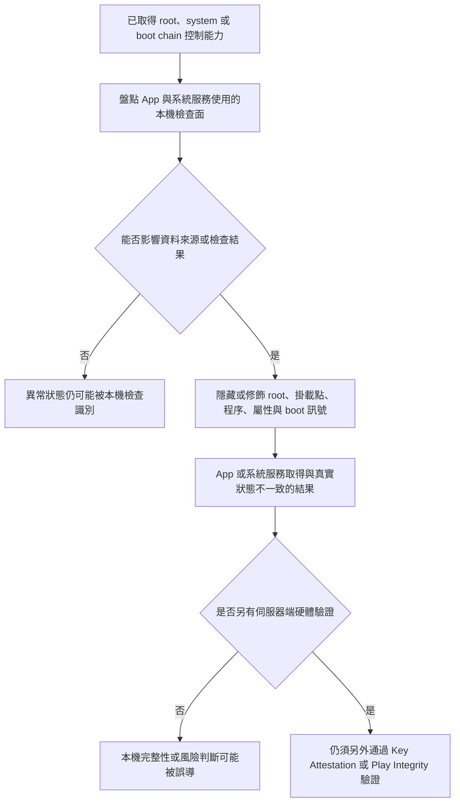
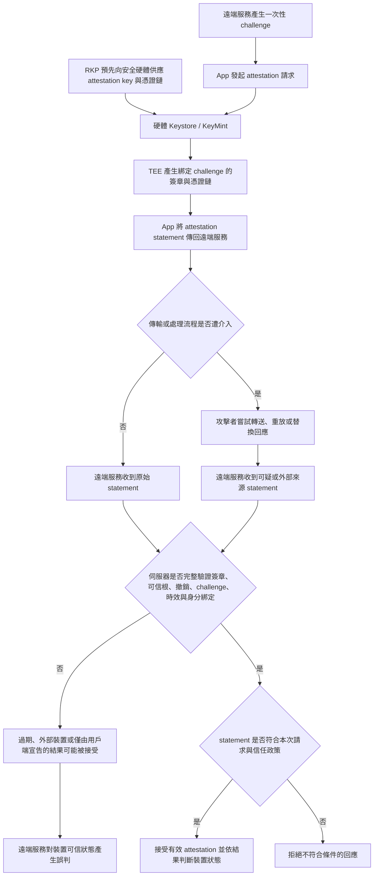
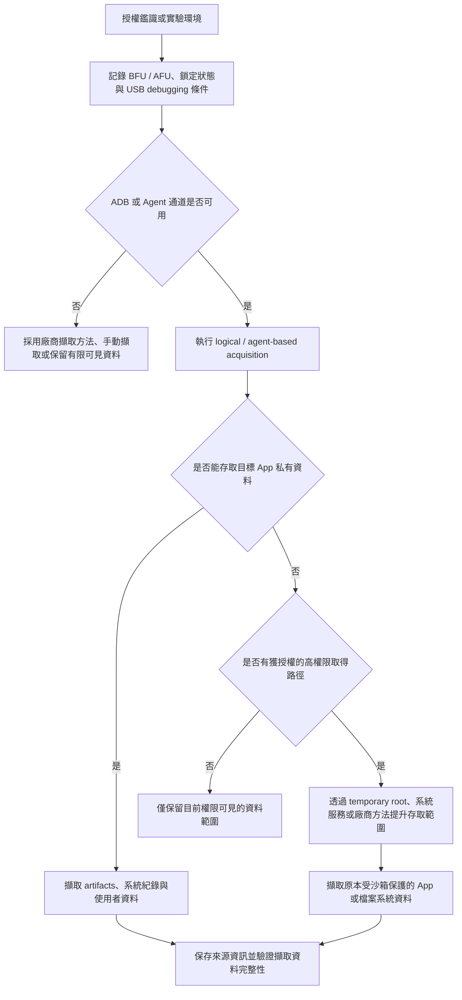
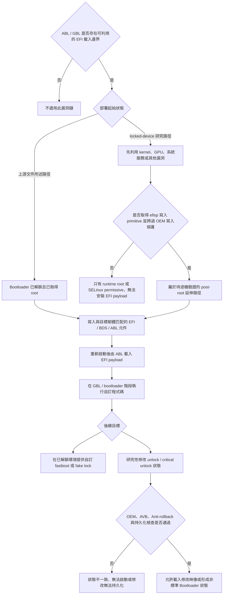
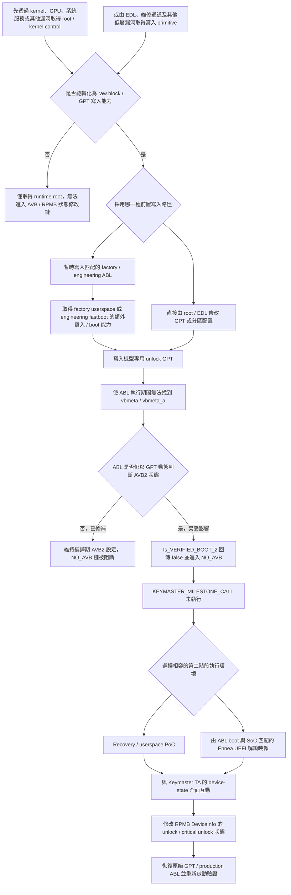
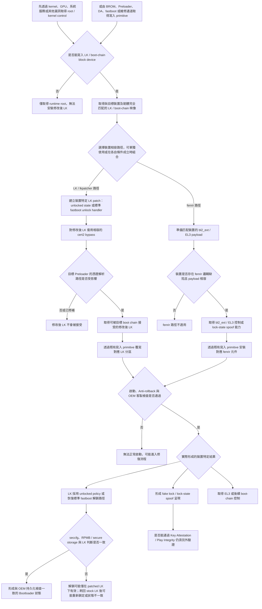
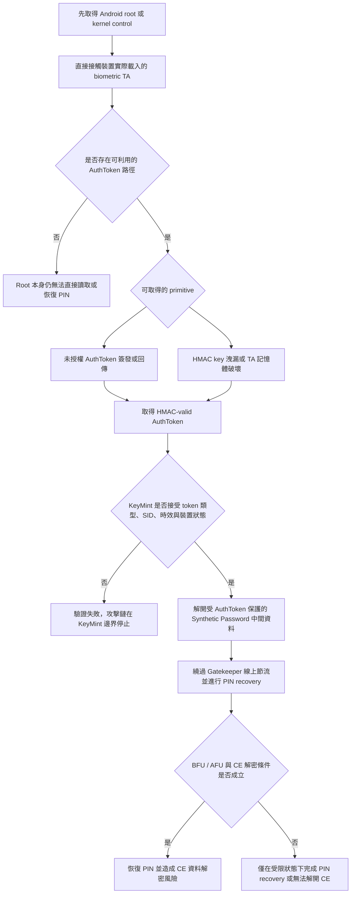
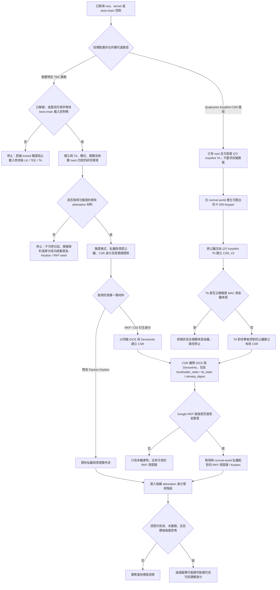

# 近期被利用之「免解鎖 Bootloader 取得 Root」漏洞列表

**語言：** 繁體中文 | [English](README.en.md)

本專案持續整理 Android platform security 研究，涵蓋 Linux kernel / GPU 本地提權、temporary root、Qualcomm ABL / GBL、MediaTek boot chain、AVB / Verified Boot，以及裝置與韌體適用性。內容以風險追蹤、修補比對與可重現性紀錄為主，不提供解鎖服務或販售 exploit。

> 用途：資安研究、風險追蹤與防護評估。
>
> 注意：請勿用於未經授權的測試或攻擊行為。
>
> AI 協作整理模型：GPT-5.6 sol with daybreak；技術結論仍以原始來源與維護者核對結果為準。
>
> 最後整理時間：2026-10-25（Asia/Taipei）

## Project scope / 專案範圍

- 追蹤公開 CVE、上游修補、PoC 與後續攻擊鏈研究。
- 記錄可能受影響的 Android 裝置、SoC、kernel / firmware 條件與修補狀態。
- 區分維護者實測、上游文件、社群回報、原始碼／韌體分析與尚未驗證的推論。
- 保留裝置與韌體版本邊界；支援清單、相同 SoC 或相同 kernel 大版本均不等同於實機可利用性。

## Evidence status / 證據狀態

| 狀態 | 使用方式 |
| --- | --- |
| `Verified / Tested` | 維護者已在表列裝置、韌體與工具組合上重現所述結果。 |
| `Tested - Not reproduced` | 維護者已測試但未重現；不代表裝置或該版本已確認不受影響。 |
| `Upstream documented` | 原始專案、官方公告、修補提交或研究者文件已明確記載；本專案未必獨立重現。 |
| `Community reported` | 第三方社群回報；若只有單一來源，不視為已確認結果。 |
| `Reverse-engineered` | 維護者依公開 source、合法取得的 firmware / application 或自有裝置獨立分析所得。此標籤描述技術事實或觀察，不代表納入第三方 implementation。 |
| `Potentially affected` | 依 SoC、kernel branch、元件或程式路徑推定可能受影響，仍需精確版本與實機驗證。 |
| `Unverified` | 尚無足夠證據或尚未由維護者測試。 |

## Research methodology / 研究方法

本專案以公開 CVE、官方 security bulletin、upstream source / patches、公開研究與 PoC 文件為主要來源。部分 interoperability、API / protocol、boot-chain 或裝置行為資訊，來自維護者在自有設備或合法取得的 firmware / applications 上所做的獨立分析。整理時盡可能保留原始連結、commit 或版本資訊，並明確區分 tested、reported、reverse-engineered、inferred 與 unverified 結果。

## Ongoing maintenance / 持續維護

維護範圍包括新 CVE / exploit technique 追蹤、affected-device / firmware matrix 更新、upstream patch status、實機驗證結果、reference correction，以及對社群回報的後續交叉驗證。既有結論會隨上游修補、專案封存或新的實機證據修正。

## Content provenance / 內容來源

- 除非段落另有標示，本文敘述、比較、表格結構與 Mermaid 圖為本專案的整理與編排。
- 外部 PoC、source、文章與產品頁僅以連結及短引用作為參考；其程式碼、文件、商標與素材仍受各自原始授權或權利約束，不因本專案採用 `GPL-3.0-only` 而被重新授權。
- 本 repository 目前未納入第三方圖片、logo、裝置照片、截圖、APK、boot image 或其他二進位資產。
- 依上游清單或原始碼自行撰寫的事實摘要，會在該節保留來源、證據狀態與授權邊界。

## 1. 已知漏洞與攻擊鏈總覽

### 1.1 漏洞 1：CVE-2025-21479（Qualcomm Adreno GPU micronode 記憶體破壞）

此漏洞出現在 Qualcomm Adreno GPU 的 micronode 指令處理流程中；公開描述指出，攻擊者可藉由特定指令序列觸發未授權命令執行與記憶體破壞。公開的 GitHub PoC 為：

- <https://github.com/zhuowei/cheese>
- <https://github.com/sarabpal-dev/cheese-cake>

若漏洞可被成功鏈接到系統提權路徑，可能進一步取得臨時 Root 權限，但實際影響仍會受到 SoC、GPU 世代、韌體版本與修補狀態影響。

CVE-2025-21479 的直接漏洞原語是 Qualcomm Adreno GPU 路徑中的未授權命令執行與記憶體破壞；若利用鏈成功取得 kernel / root 控制，攻擊者才可能在後續階段嘗試修改 SELinux 狀態。換言之，**SELinux permissive 是成功利用後可能達成的效果，不是此 CVE 本身直接提供的功能**。
這點與後述 ABL Cmdline Injection 不同：ABL 類問題是透過啟動參數注入，直接使系統以 `androidboot.selinux=permissive` 啟動。無論走哪一條路徑，取得 permissive 都不等於自動取得 root；後續仍可能需要 Xiaomi `IMQSNative` / `MQSAS`、Magica 所代表的 isolated service / isolated process 路徑，或其他高權限媒介。

社群實測回報（其他機型待驗證）：

> 證據狀態：`Community reported`。下列為單一社群來源，尚未提升為本專案的 `Verified / Tested` 結果。

- 來源：Coolapk 使用者「@羊了个羊了个羊了个羊」
- 連結：<https://www.coolapk.com/feed/70655251?s=NTFjZmEwYzkyN2NkOGUyZzY5YzYxOTM4ega1601>
- 重點：貼文內容描述在 Redmi Note 12 Turbo（標籤含 `#红米Note12Turbo`）結合 <https://github.com/zhuowei/cheese> 進行測試，回報可達到臨時 Root 相關效果。
- 註記：此為社群單點回報，建議以「可行跡象」歸檔，後續仍需多機型與多版本交叉驗證。

---

### 1.2 漏洞 2：ABL Cmdline Injection（fastboot OEM / ABL 命令列注入漏洞鏈）

此類漏洞鏈的核心在於 Qualcomm ABL（Android Bootloader）對 `fastboot oem` 某些參數的驗證不完整，導致不受信任的輸入被帶入 kernel cmdline。公開討論中，研究者展示了可藉由 OEM 指令額外注入如 `androidboot.selinux=permissive` 之類的啟動參數，進而削弱開機後的強制安全限制。

Qualcomm 對應修補提交也直接將問題描述為：

`Fix propagation of untrusted input into kernel cmdline`

因此，這條鏈本身通常不是最終目的，而是作為後續提權、臨時 Root、甚至免解鎖 Bootloader 操作的前置條件之一。

#### 1.2.1 補充：其他已知利用方式與組合鏈

除了常見的：

```bash
fastboot oem set-gpu-preemption 0 androidboot.selinux=permissive
```

另有相似利用方式：

```bash
fastboot oem set-hw-fence-value 0 androidboot.selinux=permissive
```

這類問題的核心相同，都是原本只應接受數值參數的 `fastboot oem` 指令，卻可能將額外輸入內容帶入 kernel cmdline，進而注入 `androidboot.selinux=permissive`，使系統於開機後進入 **SELinux permissive** 狀態，而非 enforcing。

已知情況如下：

- `set-gpu-preemption` 這一路徑可用於關閉 SELinux 強制執行，屬於 **Qualcomm 限定**，目前已存在修補提交。
- `set-hw-fence-value` 為另一個相似變體，亦已修補；公開討論中指出此類問題屬於較早期引入的老漏洞，理論上可能適用於更多 Qualcomm SoC。
- 版本分佈觀察（社群回報）：目前較多可利用回報集中在 **HyperOS 2 / HyperOS 3**；其他版本仍需更多樣本與獨立驗證。

此外，在 **Xiaomi 裝置** 上，公開討論中亦提到可配合使用下列系統服務呼叫：

```bash
service call miui.mqsas.IMQSNative 21 i32 1 s16 "命令" i32 1 s16 "参数列表" s16 "输出路径" i32 600
```

其重點在於：若可成功呼叫對應服務介面，可能以 **root 權限執行任意命令**。

不過，這裡的順序很重要：必須先透過 CVE-2025-21479、Qualcomm ABL cmdline injection，或其他方式使 SELinux enforcing 失效 / 進入 `SELinux permissive`，之後才有機會配合後續本機提權技巧形成完整鏈。

目前公開討論中較常被提到的後續路徑包含兩類：

1. **Xiaomi `IMQSNative` / `MQSAS` 服務路徑**：在 SELinux permissive 後，若可呼叫對應系統服務介面，可能以 root 權限執行命令。
2. **Magica / isolated service 路徑**：Magica README 將其描述為 Android 10+ 在 seccomp disabled 情境下的 privilege escalation PoC；公開討論亦提到，SELinux permissive 後可利用 isolated service / isolated process 類技巧進一步提權。

以 Xiaomi `IMQSNative` / `MQSAS` 為例，利用鏈大致可整理為：

1. 先透過 ABL 類漏洞注入 `androidboot.selinux=permissive`
2. 使系統以 **SELinux permissive** 狀態啟動
3. 再呼叫 Xiaomi 系統服務 `miui.mqsas.IMQSNative`
4. 進一步取得 **root 身份任意命令執行**

在此情況下，可形成 **完整 root 權限取得**。

若採用 Magica / isolated service 類路徑，則重點不在於特定 Xiaomi 服務，而是在 **SELinux permissive** 或其他安全限制被削弱後，利用 isolated service / isolated process 執行環境與系統服務邊界形成後續提權。  
因此，1.1 與 1.2 可視為「讓 SELinux 限制失效」的前置入口；`IMQSNative` 與 Magica 則是 permissive 之後可能銜接的不同提權分支。

參考資料：

- `set-gpu-preemption` 修補提交：
  <https://git.codelinaro.org/clo/la/abl/tianocore/edk2/-/commit/fb8e864254cdc370670233e3cb73a2b18ff33c9f>

- `set-hw-fence-value` 修補提交：
  <https://git.codelinaro.org/clo/la/abl/tianocore/edk2/-/commit/78297e8cfe091fc59c42fc33d3490e2008910fe2>

- Magica：
  <https://github.com/vvb2060/Magica>

- 討論來源：
  <https://t.me/vvb2060_Channel/17>
  <https://t.me/vvb2060_Channel/19>

> 註：
> - `ABL Cmdline Injection` 為整理用途的技術性名稱，用來統稱 fastboot OEM / ABL 參數驗證不完整、可導致 kernel cmdline 注入的漏洞鏈。
> - 小米已在 2026 年 2 月安全修補補丁中修補了相關問題

### 1.3 漏洞 3：GBL / UEFI Secure Boot Chain 類漏洞鏈（gbl_root_canoe）

參考專案：

- <https://github.com/superturtlee/gbl_root_canoe>

`gbl_root_canoe` 是近期針對新一代 Qualcomm 平台公開的 GBL / UEFI / ABL 相關研究專案。  
依照其公開說明，該專案並非單純修改 Android userspace，而是介入 **GBL / UEFI / ABL / efisp** 這一層的啟動鏈流程。

其核心風險可概括為：

- 影響範圍集中於較新的 Qualcomm 平台，尤其是 **Snapdragon 8 Elite Gen 5 / Snapdragon 8 Gen 5** 相關裝置。
- 利用點位於 Android 系統啟動前的 boot chain 階段。
- 可能透過替換、修補或重新封裝啟動鏈元件，改變裝置的啟動狀態、驗證流程或 fastboot 行為。
- 部分公開說明提到 `lockmode` / `unlockmode` 設計，顯示此類工具可能具備讓裝置在特定情境下呈現類似「假上鎖」狀態的能力。
- 此類漏洞鏈與傳統 Android userspace 提權不同，風險層級更接近 **bootloader / secure boot chain bypass**。

目前公開資料中提到的可能受影響平台，整理於 3.5「Snapdragon 8 Elite Gen 5 / Snapdragon 8 Gen 5 GBL 候選裝置」。

> 註：  
> 此處的「可能受影響」應理解為公開專案或社群研究中提到的觀察範圍，不代表每一台裝置、每一個韌體版本都已確認可利用。

---

### 1.4 漏洞 4：MTK Preloader 類漏洞鏈（OPPO / Realme / OnePlus）

參考專案：

- <https://github.com/Shocked-Cat/oppo-mtk-fastboot-unlock>

此類研究主要針對 **MediaTek 平台**，尤其是 OPPO / Realme / OnePlus 等 OPlus 系列裝置。  
公開專案描述指出，其核心方向是修改 factory preloader，並透過 mtkclient 寫入 preloader，以開啟 fastboot 存取或進一步解鎖 Bootloader。

其核心風險可概括為：

- 攻擊面位於 **MediaTek boot chain / preloader** 階段。
- 不是 Android userspace 層級漏洞。
- 可能透過修改 preloader 行為，改變裝置是否能進入 fastboot、是否能進一步執行解鎖流程。
- 在部分裝置上，解鎖或修改 boot chain 後可能造成 secure boot 狀態改變。
- 是否能達成免解鎖 Bootloader Root，需視裝置是否仍驗證後續映像、AVB / vbmeta 狀態、preloader 加密與廠商客製檢查而定。

> 註：  
> - MTK 裝置的可利用性高度依賴廠商實作。即使同為 MTK SoC，不同品牌、不同 preloader、不同 DA / auth 策略，結果也可能完全不同。
> - 已知 OPPO / Realme / OnePlus 的部分 MTK 裝置已在安全補丁 2025 年 Android 13 以上設備加密 DA，加密後僅可使用售後授權工具或是降級系統版本方式利用此類漏洞鏈。

上游支援範圍摘要與完整清單連結整理於 3.4「oppo-mtk-fastboot-unlock 上游支援摘要」。

---

### 1.5 漏洞 5：MediaTek 啟動鏈控制與 Fake Lock（fenrir / kaeru）

`fenrir` 與 `kaeru` 都在 Android userspace 啟動前介入 MediaTek boot chain，並可在受支援裝置上提供 lock-state spoofing / fake lock 功能，使實際已解鎖或載入修改內容的裝置對後續元件呈現 `locked` 狀態。不過兩者的角色並不相同：`fenrir` 直接利用 secure boot chain 的邏輯缺陷；`kaeru` 則是注入修改後 LK 的 bootloader payload，其部署通常仍需要可寫入修改 LK 的前置條件。

#### 1.5.1 fenrir：Secure Boot Chain Bypass 與 Lock-State Spoofing

參考專案：

- <https://github.com/R0rt1z2/fenrir>

> 上游狀態（2026-10-25）：repository 已於 2026-09-20 封存，README 並標示為 deprecated；本報告保留下列內容作為歷史研究與支援快照，不將其描述為持續維護中的上游專案。

`fenrir` 是針對 MediaTek secure boot chain 邏輯缺陷的公開 PoC。當 `seccfg` 為 unlocked 狀態時，部分受影響 Preloader 未正確驗證 `bl2_ext`；而 `bl2_ext` 仍以 EL3 執行並負責驗證後續映像，因此修改後的 `bl2_ext` 可破壞後續 chain of trust。

公開說明中的重點包含：

- 漏洞位於 **MediaTek secure boot chain**，可在 Preloader 執行後取得 **EL3 code execution**。
- PoC 會修改驗證策略，使未簽章或已修改的後續啟動映像可被載入。
- PoC 亦包含 lock-state spoofing，使實際 unlocked 的裝置向後續元件呈現 `locked` 狀態。
- 專案最初以 **Nothing Phone (2a)** / **CMF Phone 1** 為主要目標，之後擴展至多款 Nothing、CMF、Lenovo、Tecno、Zinwa、Redmi、POCO 與 Xiaomi 裝置。
- `fenrir` 上游已於 2026 年 9 月封存並標示為 deprecated；現有原始碼與裝置適配仍可供研究，但不應預期上游持續維護。
- Vivo X80 Pro 被作者列為已知受影響，但未列入封存前的正式支援清單。

封存前的支援範圍摘要與完整清單連結整理於 3.2「fenrir 封存上游支援摘要」。

#### 1.5.2 kaeru：LK Payload 與 Lock-State Spoofing

參考專案：

- <https://github.com/R0rt1z2/kaeru>

`kaeru` 是針對 ARMv7 MediaTek Little Kernel（LK）的 bootloader payload / patch framework。它會將自訂 payload 注入指定版本的 LK 映像，使其在 Android kernel 啟動前執行，並可依裝置適配加入自訂 fastboot 指令、修改開機模式、移除解鎖警告及執行其他 bootloader 階段操作。

在具有對應實作的裝置上，`kaeru` 可透過 lock-state spoofing 將實際 unlocked 的裝置呈現為 `locked`；公開 Release 將此能力稱為 `Lock state spoofing`，並提供 `fastboot oem bldr_spoof` 作為控制介面。

需要注意：

- `kaeru` 本身不是單一、可直接寫入所有裝置的 boot-chain exploit；修改後的 LK 仍須透過已解鎖寫入路徑、cert bypass、Preloader / BootROM 漏洞或其他裝置特定方式刷入。
- LK 中的函式位址、資料結構與 patch offset 會隨裝置及 bootloader 版本改變，因此支援狀態必須逐裝置、逐韌體確認。
- 並非所有 `kaeru` 支援裝置都具備 lock-state spoofing；應同時核對對應 `defconfig` 與 board 實作，不能只依照 Release 映像或單一設定旗標判定。

`kaeru` 目前原始碼中具備 fake-lock 實作的目標，整理於 3.3「`kaeru` Fake Lock 原始碼支援清單」。

> 註：fake lock 只代表裝置對部分本機或遠端驗證路徑呈現 `locked` 狀態，不代表原始 secure boot chain 已恢復，也不保證所有 AVB、Key Attestation 或 Play Integrity 驗證都會接受該狀態。

---

### 1.6 漏洞 6：Dirty Pipe（CVE-2022-0847）

Dirty Pipe（CVE-2022-0847）是 Linux kernel 中曾被公開利用的本地提權漏洞。  
此漏洞與 pipe buffer / page cache 寫入行為有關，攻擊者在特定條件下可能修改原本只讀的檔案快取內容，進而造成權限提升。

參考資料：

- CVE-2022-0847：<https://nvd.nist.gov/vuln/detail/CVE-2022-0847>
- Dirty Pipe 說明：<https://dirtypipe.cm4all.com/>
- Android 相關研究案例：<https://github.com/polygraphene/DirtyPipe-Android>
- Android 相關研究案例：<https://github.com/tiann/DirtyPipeRoot>

### 1.7 漏洞 7：GhostLock（CVE-2026-43499）

GhostLock 是 Linux kernel `rtmutex` / `futex_requeue()` 路徑中的 Use-After-Free 本地提權漏洞。
問題出現在 proxy-lock rollback 流程：`remove_waiter()` 在特定情況下錯誤操作 `current`，而不是實際的 `waiter::task`，可能留下未清除的 `pi_blocked_on` dangling pointer，進而形成可被利用的 UAF。

此漏洞已從 Linux 完整 exploit 進展到 Android 實機適配階段。公開專案中，NebuSec / CyberMeowfia 同時提供觸發 PoC 與 exploit 實作；後續亦出現針對 Android 16、Xiaomi 17 系列，以及 Samsung Galaxy 特定韌體的移植與工具鏈。

#### 1.7.1 Android 影響評估

- Android 常見的 Linux 5.10、6.1、6.6 與 6.12 分支都可能因實際程式碼與 backport 狀態而受到影響。
- NVD 列出的已修補穩定分支邊界包含 `6.1.175`、`6.6.140`、`6.12.86`、`6.18.27` 與 `7.0.4`；OEM kernel 可能提前回補等效修正，因此不能只依版本字串判定。
- 已有 Xiaomi 17 Pro Max（`popsicle`，Android 16 / kernel 6.12）公開實機適配；其他專案則提供依 `boot.img`、kernel layout 與裝置 profile 產生特定 payload 的框架。
- 此漏洞可作為 temporary root、kernel control 或後續 LKM root 的第一階段，但本身不等於解鎖 Bootloader、繞過 AVB 或取得持久化 root。

#### 1.7.2 公開狀態

| 項目 | 狀態 |
| --- | --- |
| 漏洞類型 | Linux Kernel UAF / Local Privilege Escalation |
| Linux exploit | 已公開 |
| Android 實機適配 | 已公開，包含 Xiaomi 與 Samsung 特定韌體案例 |
| 是否通用 | 否，需精準匹配 kernel、韌體、layout 與 profile |
| 是否可直接解鎖 Bootloader | 否 |
| 報告定位 | Kernel LPE / Temporary Root / Android 高優先追蹤 |

參考資料：

- NVD：<https://nvd.nist.gov/vuln/detail/CVE-2026-43499>
- 原始公開 exploit：<https://github.com/NebuSec/CyberMeowfia/tree/main/IonStack/CVE-2026-43499/exploit>
- Xiaomi 17 系列 Android 適配：<https://github.com/x-spy/CVE-2026-43499-popsicle>
- Android arm64 適配框架：<https://github.com/Linuxoid-cn/CVE-2026-43499-Poc-Analysis>
- Samsung Galaxy 適配工具鏈：<https://github.com/BuSung-dev/Root-My-Galaxy>

### 1.8 漏洞 8：Bad Epoll（CVE-2026-46242）

Bad Epoll 是 Linux kernel `epoll` / `eventpoll` 子系統中的 race-condition Use-After-Free。
公開研究顯示，低權限本機程序可在受影響的 Linux kernel 上將此 UAF 發展為 kernel local privilege escalation；漏洞由 commit `58c9b016e128` 引入，並於 commit `a6dc643c6931` 修補。

#### 1.8.1 Android 影響評估

- 漏洞自 Linux v6.4 引入，因此使用 6.6、6.12 等較新 kernel 基線且尚未回補修正的 Android 裝置屬於候選範圍。
- 作者已在 Pixel 10 的 v6.6+ kernel 上觸發 UAF，但截至公開說明所載，完整 Android root exploit 仍在開發中。
- Pixel 8 與其他以原始 v6.1 為基線、且未回補引入 commit 的裝置不受此上游漏洞影響。
- OEM 可能選擇性 backport 引入或修補，因此最終仍須比對實際 kernel source、commit 與韌體版本，不能僅依 Android 版本或 `uname -r` 判定。

#### 1.8.2 公開狀態

| 項目 | 狀態 |
| --- | --- |
| 漏洞類型 | Linux Kernel epoll UAF / Local Privilege Escalation |
| Linux exploit | 已公開，kernelCTF 目標已有完整利用鏈 |
| Android trigger | 已公開確認可在 Pixel 10 v6.6+ 觸發 UAF |
| Android 完整 root exploit | 尚未公開完成 |
| 是否直接解鎖 Bootloader | 否 |
| 報告定位 | Kernel LPE / Android 高優先待驗證 |

參考資料：

- Bad Epoll 研究與 PoC：<https://github.com/J-jaeyoung/bad-epoll>
- NVD：<https://nvd.nist.gov/vuln/detail/CVE-2026-46242>
- oss-security 公告：<https://www.openwall.com/lists/oss-security/2026/07/08/13>

### 1.9 漏洞 9：CVE-2026-21385（Qualcomm Display / Graphics 記憶體破壞）

CVE-2026-21385 是 Qualcomm Display / Graphics 元件在處理記憶體配置 alignment 時可能發生的 integer overflow / memory corruption。
Qualcomm 給出的 CVSS v3.1 分數為 7.8（High），攻擊向量為本機、低權限、無需使用者互動；Android 2026 年 3 月安全公告將其列為 Qualcomm Display 高風險漏洞。

此漏洞的重要性在於 Android 官方公告指出已有 **limited, targeted exploitation** 跡象，且 CISA 已將其納入 Known Exploited Vulnerabilities（KEV）目錄。這表示它不只是理論上的記憶體破壞問題，而是需要優先追蹤裝置修補狀態的已知利用風險。

#### 1.9.1 Android 影響評估

- 影響範圍應以 Qualcomm 公告中的受影響 chipset、OEM 韌體與實際安全修補內容為準，不能直接推論所有 Qualcomm / Adreno 裝置皆可利用。
- 公開 trigger、crash 或「已造成 overflow」只代表漏洞路徑可能可達，不等於已取得可控記憶體破壞，也不等於存在公開的 Android root exploit。
- 截至本次整理，尚未確認有可跨裝置重現的完整公開 Android root PoC。
- 若能在特定裝置上形成穩定 exploit primitive，可能作為 app-to-kernel、temporary root 或其他漏洞鏈的前置階段；但它本身不直接解鎖 Bootloader。

#### 1.9.2 公開狀態

| 項目 | 狀態 |
| --- | --- |
| 漏洞類型 | Qualcomm Display / Graphics Memory Corruption |
| 官方嚴重度 | High（CVSS 7.8） |
| 已知利用狀態 | Android 公告指出有限、目標式利用；已列入 CISA KEV |
| 公開完整 Android root PoC | 未確認 |
| 是否直接解鎖 Bootloader | 否 |
| 報告定位 | Qualcomm Graphics 攻擊面 / 已知遭利用 / 極高優先追蹤 |

參考資料：

- Android Security Bulletin（2026-03）：<https://source.android.com/docs/security/bulletin/2026/2026-03-01>
- Qualcomm March 2026 Security Bulletin：<https://docs.qualcomm.com/product/publicresources/securitybulletin/march-2026-bulletin.html>
- NVD：<https://nvd.nist.gov/vuln/detail/CVE-2026-21385>

### 1.10 漏洞 10：DirtyFrag（CVE-2026-43284，Linux XFRM / ESP Page-Cache Write）

DirtyFrag 是 Linux kernel XFRM / IPsec ESP 路徑中的 page-cache write 漏洞。當檔案頁面經由 `splice()` 進入 UDP / ESP 處理路徑時，受影響 kernel 可能在未先建立私有副本的情況下，直接於共享的 file-backed page 上進行解密或更新，讓本機低權限程序修改唯讀檔案在記憶體中的 page cache 內容。

此漏洞特別值得納入 Android 追蹤，因為公開專案已不只提供 Linux 觸發器，而是將 `CVE-2026-43284` 發展為 Android temporary root 與 KernelSU late-load 工具鏈：

- `DFRoot` 使用 page-cache write primitive 修改程序後續會執行的共享程式庫頁面，再載入相容的自訂 kernel module；專案定位是不需先解鎖 Bootloader 的 temporary root 工具。
- `GhostSam` 同時整合 GhostLock 與 DirtyFrag 路徑。其 DirtyFrag 路徑依 Android KMI 選擇對應模組，公開 README 列出 `android12-5.10`、`android13-5.15`、`android15-6.6` 與 `android16-6.12` 已測試，其他 KMI 則標示未測試或僅部分支援。
- `GhostSam` 公開列出的裝置目標包含 Galaxy S22、Galaxy S26 與 Galaxy Z Fold8；這是專案支援聲明，不代表同系列所有區域、SoC 與韌體都已獨立驗證。

> 註：DirtyFrag 研究亦包含另一條 RxRPC page-cache write 路徑 `CVE-2026-43500`。本節與上述 Android 工具所指的是 XFRM / ESP 路徑的 `CVE-2026-43284`，兩者不應混為同一 CVE。

#### 1.10.1 Android 影響評估

- 公開工具已提供特定 Android kernel / KMI 組合的 temporary root 實作與支援聲明，公開程度已超出單純 crash PoC；各裝置結果仍須獨立重現。
- 實際可利用性仍取決於 XFRM / ESP 功能是否可達、kernel 是否包含上游修補或 OEM 等效 backport、KMI 與模組是否匹配，以及 SELinux、seccomp 與 OEM 防護差異。
- 成功取得 temporary root 或 late-load KernelSU 不等於 Bootloader 已解鎖，也不表示 AVB、Secure Boot 或持久化狀態已被改變。
- Microsoft 公開報告描述有限的野外活動，其行為可能與 DirtyFrag 或 Copy Fail 技術相關；由於遙測無法將觀察結果唯一歸因至 `CVE-2026-43284`，本文將其標記為「存在有限疑似野外利用訊號」，而非已確認的單一 CVE 歸因。

#### 1.10.2 公開狀態

| 項目 | 狀態 |
| --- | --- |
| 漏洞類型 | Linux Kernel XFRM / ESP Page-Cache Write / Local Privilege Escalation |
| Linux exploit | 已公開 |
| Android 工具鏈 | 已公開，包含 DFRoot 與 GhostSam |
| Android 適配方式 | 需匹配實際 kernel、KMI、修補狀態與可載入模組 |
| 野外利用證據 | Microsoft 回報有限疑似活動，但未唯一歸因至本 CVE |
| 是否直接解鎖 Bootloader | 否 |
| 報告定位 | Kernel LPE / Temporary Root / 已公開武器化 Android 鏈 |

參考資料：

- DFRoot：<https://github.com/diabl0w/DFRoot>
- GhostSam：<https://github.com/snothin/GhostSam>
- Linux mainline 修補：<https://git.kernel.org/linus/f4c50a4034e62ab75f1d5cdd191dd5f9c77fdff4>
- Microsoft DirtyFrag active-attack 研究：<https://www.microsoft.com/en-us/security/blog/2026/05/08/active-attack-dirty-frag-linux-vulnerability-expands-post-compromise-risk/>
- NVD：<https://nvd.nist.gov/vuln/detail/CVE-2026-43284>

### 1.11 漏洞 11：CVE-2026-64560（POSIX CPU Timers Non-leader Exec UAF）

`CVE-2026-64560` 是 Linux kernel POSIX CPU timer 路徑中的 race-condition Use-After-Free。當非 leader thread 執行 `exec()` 並替換 thread-group leader 時，另一個執行緒可能在刪除或更新 CPU timer 的過程中觀察到舊 leader，使仍掛在 timer queue 內的 `struct k_itimer` 被釋放；後續 timer 操作即可存取已釋放物件。

此漏洞的 CVSS v3.1 分數為 7.8（High），攻擊向量為本機、低權限、無需使用者互動。公開 exploit 已在 Pixel 10 Pro 的指定 Android 17 build 上取得 root shell 並修改 SELinux 狀態，後續亦出現 Xiaomi 15 與 Redmi K90 的裝置特定移植。

#### 1.11.1 Android 公開適配狀態

| 裝置 / 專案 | 公開狀態 | 證據邊界 |
| --- | --- | --- |
| Pixel 10 Pro | NebuSec / CyberMeowfia 公開完整 exploit，指定 July 2026 Android 17 build | 原始公開驗證目標；結果仍綁定該 kernel 與 build |
| Xiaomi 15 (`dada`) | 公開 exact-build adaptation，綁定 `OS4.0.0.8.XOCCNXM`、指定 fingerprint、kernel 與映像 hash | 專案宣稱提供當次開機 temporary root；本報告未獨立重現 |
| Redmi K90 (`annibale`) | 公開 fork 宣稱已完成實機 full chain | README 仍保留上游 `dada` fingerprint、kernel 與部分 metadata，應先視為專案聲明並等待獨立交叉驗證 |

#### 1.11.2 影響與限制

- 這不是只依 Android 版本或 kernel 大版本即可判定的通用 exploit。OEM backport、allocator 行為、頁面配置、offset、race 參數與 exact build 都會影響利用結果。
- 公開移植專案已使其進入「積極適配 / 武器化」階段，但截至本次整理，尚未找到可將 `CVE-2026-64560` 明確標為已遭野外利用的官方證據。
- 目前公開成果屬於 runtime kernel LPE / temporary root；它本身不直接解鎖 Bootloader，也不保證能跨重開機持久化。
- 同一 SoC 或相近 kernel 字串不代表既有 payload 可直接共用。應要求完整 fingerprint、`/proc/version`、boot / Image hash 與實機 `uid=0` 證據一致。

#### 1.11.3 公開狀態

| 項目 | 狀態 |
| --- | --- |
| 漏洞類型 | Linux Kernel POSIX CPU Timers UAF / Local Privilege Escalation |
| 官方嚴重度 | High（CVSS 7.8） |
| Android 完整 exploit | 已公開 |
| Android 實機適配 | 已有 Pixel 與 Xiaomi 特定 build 案例 |
| 是否通用 | 否，需逐裝置、逐韌體、逐 kernel 適配 |
| 已確認野外利用 | 未確認 |
| 是否直接解鎖 Bootloader | 否 |
| 報告定位 | Kernel LPE / Temporary Root / 積極移植中的 N-day |

參考資料：

- GitHub Advisory：<https://github.com/advisories/GHSA-78ph-mc3q-52vv>
- NebuSec 漏洞與 exploit 說明：<https://nebusec.ai/buglist/CVE-2026-64560/>
- Xiaomi 15 (`dada`) 適配：<https://github.com/quyicheng03-boop/xiaomi15-dada-cve-2026-64560>
- Redmi K90 (`annibale`) 適配：<https://github.com/morannlx/RedmiK90-dada-cve-2026-64560>
- NVD：<https://nvd.nist.gov/vuln/detail/CVE-2026-64560>

## 2. 可能被利用的後續攻擊手法

本節整理的是公開研究中常被搭配討論的攻擊手法。  
這些手法可以出現在不同階段：裝置端狀態被改變時、本機 App 或系統服務進行檢查時、網路驗證流程傳輸時，或遠端服務判斷裝置可信狀態時。

整理重點放在：

- 攻擊手法作用在哪一層
- 主要想繞過或干擾什麼判斷
- 常見需要搭配哪些條件
- 對裝置、App 或遠端服務可能造成什麼影響

> 流程圖閱讀方式：各小節代表不同攻擊面，並非必然依照 `2.1` 到 `2.8` 串成同一條漏洞鏈；菱形節點用來表示必要條件、修補狀態或信任邊界，任一條件不成立都可能使該路徑停止。

其中 `2.5` 與 `2.6` 特別描述 **post-root boot-chain manipulation**：先由其他漏洞取得 root / kernel control，再將該權限轉化為 GPT、LK 或其他 boot-chain 分區的寫入能力，以進一步影響 Bootloader 狀態。兩節不是用來說明第一階段如何取得 root。

`2.7` 與 `2.8` 則描述 **post-root / post-bootchain trust-boundary expansion**：前者嘗試將 root 延伸為 PIN recovery / CE bypass，後者關注 TEE、KeyMint、RKP 與 Keybox 身分材料是否可能被擷取、重新簽發或移植。

### 2.1 本機繞過：裝置端信任狀態偽裝

本機繞過指的是攻擊者已經在裝置端取得足夠控制能力後，嘗試改變或隱藏本機可觀察到的狀態，使 App、系統服務或完整性檢查元件無法正確判斷裝置是否已被修改。

常見被關注的判斷面包含：

- Bootloader 是否為 locked
- Verified Boot / AVB 狀態是否正常
- 裝置是否使用可信 boot key
- SELinux 是否仍為 enforcing
- 是否存在 root、注入框架、可疑掛載點或被修改的系統屬性
- Key Attestation / Play Integrity 回傳結果是否與真實裝置狀態一致

本機繞過的重點在於讓裝置端檢查結果與真實狀態產生落差。例如：裝置實際已被修改，但 App 或系統服務仍看到接近正常、上鎖或可信的狀態。

#### 2.1.1 流程示意



#### 2.1.2 風險定位

| 分類 | 內容 |
| --- | --- |
| 類型 | Post-root / Post-bootchain-compromise Local Bypass |
| 攻擊位置 | 裝置本機、App 檢查流程、系統服務回傳結果 |
| 主要用途 | 偽裝本機裝置狀態、降低 App 或系統服務偵測機率 |
| 相關機制 | Boot state、AVB、SELinux、系統屬性、root 偵測、Key Attestation / Play Integrity 本機呼叫結果 |
| 常見前提 | 已能影響本機檢查流程、系統屬性、回傳結果或執行環境 |
| 風險重點 | 本機檢查可能被誤導，錯判裝置仍處於可信或未修改狀態 |

### 2.2 中間人 / 轉送攻擊：Key Attestation 驗證流程干擾

參考專案：

- <https://github.com/vocolboy/RemoteKeyAttestation>

> 定位說明：上述專案是 RKA / RKP 與 Play Integrity 的研究及示範，不是「任意網路中間人都能竄改硬體 attestation」的通用 PoC。RKA / RKP 是金鑰與憑證供應機制；真正的攻擊面在於驗證結果被轉送、替換或重放時，伺服器端是否完整驗證簽章、challenge、憑證鏈、撤銷狀態與請求綁定。

此類研究重點在於 Remote Key Attestation / Key Attestation 驗證流程中的信任邊界。  
攻擊者可能嘗試介入 App、驗證服務與 attestation 結果之間的傳輸或處理流程，使驗證方收到被替換、重放、轉發或不符合原始裝置狀態的結果。

在這類情境中，風險重點在於驗證流程是否完整綁定：

- challenge / nonce 是否不可重放
- 回傳結果是否與當次請求、帳號、裝置與 App 身分綁定
- 憑證鏈與硬體信任來源是否被正確驗證
- App 與遠端服務之間的傳輸與回應是否可被插入或替換
- 驗證服務是否只相信用戶端回報，而沒有在伺服器端重新驗證 attestation statement

因此，中間人攻擊應被視為「驗證流程層」的問題。它的重點是干擾或誤導遠端驗證結果，使服務端對裝置可信狀態產生錯誤判斷。

#### 2.2.1 流程示意



#### 2.2.2 風險定位

| 分類 | 內容 |
| --- | --- |
| 類型 | Attestation Relay / Response Substitution / Verification Bypass |
| 攻擊位置 | App 與遠端驗證服務之間的請求、回應或資料處理流程 |
| 主要用途 | 干擾遠端完整性驗證流程，影響服務端對裝置可信狀態的判斷 |
| 相關機制 | Remote Key Attestation、Key Attestation、RKP、Play Integrity、challenge / nonce、憑證鏈驗證 |
| 常見前提 | 伺服器未完整驗證簽章、challenge、時效、憑證鏈、撤銷狀態，或未綁定裝置、App、帳號與當次請求 |
| 風險重點 | 遠端服務可能被中間人流程誤導，錯判裝置仍處於可信狀態 |

### 2.3 ADB / Agent 輔助取證：應用程式資料取得

行動裝置鑑識常見目標之一，是在合法授權或實驗環境下取得應用程式資料、系統紀錄、媒體檔案、帳號痕跡、通訊紀錄與其他可供分析的 artifacts。  
Android 官方文件將 ADB 定位為可與裝置通訊、安裝與除錯應用程式、取得 Unix shell 的命令列工具；因此在鑑識流程中，ADB 常被作為裝置連線、邏輯擷取、代理程式部署或資料匯出的基礎通道。

此類手法的核心限制在於 Android 的應用程式沙箱與儲存隔離。  
Android 官方文件指出，App 的 internal storage 預設不允許其他 App 存取，且 Android 10 以上這些位置會加密；這使得一般 ADB、MTP 或未提權代理程式通常只能取得部分使用者資料、外部儲存資料、媒體檔、可匯出的 App 資料或畫面/互動層資料。

因此，部分鑑識工具會依裝置狀態與授權範圍，採用不同層級的取得方式，例如：

- 標準 ADB 或 agent-based backup
- 安裝輔助 App 進行 logical extraction
- 對已 root 裝置進行 logical / physical backup
- 針對特定 SoC 或廠商實作的 dump / acquisition method
- 在無法取得檔案系統資料時，改用畫面擷取、手動擷取或 App 支援的匯出能力

在風險分類上，ADB / Agent 輔助取證不一定代表漏洞利用；但如果搭配 ADB 提權漏洞、系統服務漏洞、SELinux 繞過或 boot chain 狀態改變，就可能從「一般邏輯擷取」提升為「可存取私有 App 資料或更完整檔案系統資料」的取證路徑。

#### 2.3.1 流程示意



#### 2.3.2 風險定位

| 分類 | 內容 |
| --- | --- |
| 類型 | ADB / Agent-assisted Forensic Acquisition |
| 攻擊位置 | ADB 通道、裝置端 agent、應用程式資料與檔案系統存取邊界 |
| 主要用途 | 取得應用程式 artifacts、使用者資料、系統紀錄、媒體檔案或可供鑑識分析的資料 |
| 相關機制 | ADB、adbd、Android app sandbox、internal storage、logical extraction、agent-based extraction |
| 常見前提 | 裝置已解鎖、USB debugging 可用、使用者授權、可安裝 agent，或已具備更高權限 |
| 風險重點 | 若搭配提權或系統層漏洞，可能突破一般邏輯擷取限制，取得原本受沙箱保護的 App 私有資料 |

參考資料：

- NIST SP 800-101 Rev. 1：<https://csrc.nist.gov/pubs/sp/800/101/r1/final>
- Android Debug Bridge：<https://developer.android.com/tools/adb>
- Android app-specific storage：<https://developer.android.com/training/data-storage/app-specific>
- Magnet Acquire：<https://www.magnetforensics.com/resources/magnet-acquire/>
- Belkasoft X Forensic：<https://belkasoft.com/x>
- Oxygen Forensics Android Agent：<https://www.oxygenforensics.com/technical-resources/android-agent/>

### 2.4 Qualcomm GBL / UEFI Boot Chain 操控與解鎖狀態風險

近期熱門的 Qualcomm GBL 解鎖 Bootloader 研究，重點在於新一代 Android boot chain 中 **Qualcomm ABL / GBL / UEFI / efisp** 之間的載入與驗證邊界。  
公開報導指出，部分 Android 16 / Qualcomm 平台上，Qualcomm ABL 會嘗試從 `efisp` 分區載入 GBL 相關 UEFI app；問題在於載入流程可能只確認該內容是否為 UEFI app，而沒有充分驗證其是否為可信、原廠預期的 GBL 元件。這使攻擊者在具備寫入 `efisp` 的前提下，可能讓自訂 UEFI app 於 bootloader 階段被執行。

需要區分公開工具已證明的部署路徑與本報告延伸討論的攻擊假設：`gbl_root_canoe` 公開文件所描述的安裝流程，前提是裝置 **Bootloader 已解鎖且已取得 root**，再寫入對應元件以提供自訂 fastboot / boot-chain 行為與 fake lock。它本身不能直接作為「locked 裝置可由零開始解鎖」的證據。
本報告另行討論的 locked-device 路徑屬於 post-root 風險推演：若攻擊者已透過其他漏洞取得 kernel control 或 `efisp` block-device 寫入 primitive，且能跨過 OEM 寫入保護、Anti-rollback 與持久化檢查，才可能利用同一載入邊界進一步影響 unlock state。此路徑必須逐裝置與韌體獨立驗證。

這條鏈之所以重要，是因為利用點發生在 **Android 系統啟動前的 boot chain 階段**。  
一旦可在該階段執行非預期程式碼，就可能影響 bootloader lock state、critical unlock state、fastboot 行為、Verified Boot 判斷或後續系統啟動狀態。

公開資料中提到的常見組合鏈大致包含：

- **GBL / efisp 載入驗證缺口**：ABL 從 `efisp` 載入 UEFI app 時，未完整驗證其真實性或預期身分。
- **寫入 `efisp` 的能力**：通常需要先透過其他漏洞、系統服務、root、SELinux permissive 或廠商特定通道取得寫入能力。
- **fastboot OEM / ABL cmdline injection**：部分鏈會搭配 Qualcomm ABL fastboot OEM 參數驗證問題，使 SELinux 進入 permissive 或降低後續寫入限制。
- **廠商服務漏洞或系統層能力**：例如公開報導中提到 Xiaomi HyperOS / MQSAS 相關能力，可作為特定機型上的寫入或提權環節。
- **Bootloader 狀態修改**：自訂 UEFI app 被載入後，可能修改 `is_unlocked`、`is_unlocked_critical` 或等效狀態，使裝置呈現可解鎖或已解鎖狀態。

需要特別區分：`SELinux permissive` 只代表 SELinux policy 不再強制阻擋，並不會自動提供 root、block device capability 或 `efisp` 寫入權限。實際鏈中仍須串接 root、廠商高權限服務或其他可寫入分區的 primitive。

因此，這類漏洞鏈的核心風險在於繞過 OEM 對 Bootloader 解鎖流程的限制，讓原本無法或難以官方解鎖的機型進入可刷寫、可修改或非標準可信狀態。對鑑識與研究而言，這代表可能出現新的底層存取路徑；對防護而言，則代表 boot chain 驗證、`efisp` 寫入控制、fastboot OEM 指令驗證與廠商系統服務權限邊界都需要一併檢查。

#### 2.4.1 流程示意



#### 2.4.2 風險定位

| 分類 | 內容 |
| --- | --- |
| 類型 | Qualcomm GBL / ABL Boot Chain Manipulation |
| 攻擊位置 | Qualcomm ABL、GBL、UEFI app、`efisp` 分區、bootloader lock state |
| 主要用途 | 已解鎖環境中的 fake lock / 自訂 fastboot，以及具備額外寫入 primitive 時可能發生的 unlock-state 操控 |
| 相關機制 | GBL、UEFI、efisp、ABL、fastboot OEM、SELinux permissive、Verified Boot / AVB |
| 常見前提 | 上游部署路徑要求已解鎖與 root；locked-device 推演另需可寫入 `efisp` 的前置能力及裝置特定驗證 |
| 風險重點 | 可在 Android userspace 之前影響 boot chain；但 fake lock、初始解鎖與 post-root 狀態修改必須分開判定 |

#### 2.4.3 目前觀察

- 主要公開焦點集中在 **Snapdragon 8 Elite Gen 5** 與 Android 16 / GBL 架構裝置。
- 公開報導提到 Xiaomi 17 series、Redmi K90 Pro Max、POCO F8 Ultra 等裝置已有相關解鎖案例。
- Samsung 等採用自家 bootloader 實作的裝置，是否受影響需另行判斷，不能直接套用 Qualcomm ABL / GBL 鏈的結論。

參考資料：

- gbl_root_canoe：<https://github.com/superturtlee/gbl_root_canoe>
- Android Authority：<https://www.androidauthority.com/qualcomm-snapdragon-8-elite-gbl-exploit-bootloader-unlock-3648651/>
- Android GBL overview：<https://source.android.com/docs/core/architecture/bootloader/generic-bootloader>
- GBL fastboot：<https://android.googlesource.com/platform/bootable/libbootloader/+/refs/heads/main/gbl/docs/gbl_fastboot.md>
- Android bootloader lock / unlock：<https://source.android.com/docs/core/architecture/bootloader/locking_unlocking>

### 2.5 Qualcomm AVB / NO_AVB Bootloader 狀態漏洞

參考專案：

- <https://github.com/atlas4381/qualcomm_avb_exploit_poc>
- <https://github.com/kasnria001/qualcomm_noavb_exploit_common>
- Mi8G3-Unlocker：<https://github.com/Linuxoid-cn/Mi8G3-Unlocker>
- Mi8G2-Unlocker：<https://github.com/Linuxoid-cn/Mi8G2-Unlocker>
- Mi8sG4-Unlocker：<https://github.com/Linuxoid-cn/Mi8sG4-Unlocker>
- Mi8sG3orMi7pG3-Unlocker：<https://github.com/Linuxoid-cn/Mi8sG3orMi7pG3-Unlocker>
- Mi8E-Unlocker：<https://github.com/Linuxoid-cn/Mi8E-Unlocker>

本節列在「可能被利用的後續攻擊手法」，是因為攻擊者若已透過 kernel、GPU、系統服務或其他漏洞取得 root / kernel control，並進一步取得 raw block device、GPT 或相關 boot-chain 分區的寫入能力，就可能把第一階段的 temporary root 延伸為 Bootloader device state 修改。此類能力也可能來自 EDL、維修通道或其他低層寫入漏洞，但 **Qualcomm AVB / NO_AVB 問題本身不是第一階段 root 漏洞**。

與 `2.6` 由 patched LK 本身改變解鎖政策的路徑不同，`2.5` 最終依賴的是 `NO_AVB`、Keymaster milestone 與 RPMB device-state 缺口。不過，部分實際工具會先**暫時刷入 factory / engineering ABL**，利用其額外的工程啟動、fastboot 或刷寫能力修改 GPT 並啟動第二階段 payload；因此，ABL 替換可以是這條鏈的前置媒介，但不是最後改寫 lock state 的漏洞 primitive。

需要注意的是，root 身分不必然等於可直接改寫 GPT、`vbmeta`、ABL 或其他受保護分區。SELinux、Linux capability、唯讀 block mapping、UFS write protection、Anti-rollback 與 OEM 儲存服務都可能阻擋寫入；只有在 root / kernel control 能進一步轉化為有效的底層寫入 primitive 時，後續 AVB / RPMB 狀態鏈才可能成立。

此類研究聚焦於 Qualcomm ABL 對 **Android Verified Boot 2.0（AVB2）** 狀態的判斷方式，以及該判斷結果如何影響後續 Keymaster TA、RPMB device state 與 bootloader unlock state。  
公開 PoC 說明指出，部分 vulnerable ABL build 會在執行期間檢查 GPT 中是否存在 `vbmeta_a` 或 `vbmeta` 分區，以決定是否走 AVB2 路徑；若未找到對應分區，ABL 可能落入 `NO_AVB` 路徑。

問題在於，`NO_AVB` 路徑可能不會設定正常 AVB2 流程中的 Keymaster milestone。  
在 milestone 未被設定的情況下，Keymaster TA 對 device state 的讀寫限制可能不足，進而讓攻擊者在具備底層分區表或分區寫入能力時，影響 RPMB 中與 bootloader 狀態相關的資料，例如 unlock / critical unlock 狀態。

這條鏈的核心位於 **AVB 判斷、Keymaster milestone、RPMB device state** 之間的狀態銜接缺口。  
若成立，可能造成裝置繞過標準 `fastboot oem unlock` 或官方解鎖流程，進入 bootloader unlocked 或 critical unlocked 狀態。

公開資料中提到的關鍵點包含：

- **AVB2 狀態判斷依賴分區表觀察結果**：ABL 以執行期間找到 `vbmeta` / `vbmeta_a` 與否，決定是否走 AVB2。
- **NO_AVB 路徑缺少 milestone 約束**：進入 `NO_AVB` 後，Keymaster milestone 可能未被設定。
- **Keymaster TA device state 操作邊界不足**：在 milestone 未設定時，與 device state 相關的讀寫操作可能未被阻擋。
- **RPMB 中 bootloader 狀態受影響**：bootloader unlock / critical unlock 狀態可能被寫回到受保護儲存中的 device state。
- **修補方向**：公開修補提交將 AVB2 狀態改為依 `VERIFIED_BOOT_ENABLED` 等編譯期設定決定，避免執行期間被 GPT 分區表變動影響。

#### 2.5.1 Factory / Engineering ABL、Unlock GPT 與 Ennea 路徑

Linuxoid-cn 公開的多個 Xiaomi 平台解鎖輔助專案，將 temporary root、factory / engineering ABL、機型專用 GPT 與 `Ennea.img` 解鎖映像整合成自動化流程。各平台細節並不完全相同，但公開 README、Release 結構與腳本呈現的共通設計可概括為：

1. 先透過既有漏洞取得 temporary root / kernel control，或由 EDL、維修通道等方式取得 ABL / GPT 寫入能力。
2. 視機型暫時寫入匹配的 factory / engineering ABL，使 locked 裝置可進入額外的工程啟動環境，或取得原本不可用的 fastboot flash / boot 能力。
3. 透過 factory userspace、既有 root 服務或 engineering fastboot 寫入機型專用 `unlockGPT`。其效果通常是修改 GPT partition entry，將 `vbmeta` / `vbmeta_a` 重新命名、隱藏或改成 ABL 無法辨識的名稱，而不是在 Android 檔案系統中重新命名一般檔案。
4. 透過 ABL 啟動與 SoC 匹配的 `Ennea.img`。此類映像扮演第二階段解鎖 payload，在 `NO_AVB` / milestone 未設定的條件下，進一步與 Keymaster TA / RPMB device state 流程互動。
5. device state 更新完成後，部分工具會恢復原始 GPT 與 production ABL，再檢查實際 unlock state；若中途版本、slot、GPT 或 Anti-rollback 狀態不匹配，可能造成無法啟動或永久損壞。

公開專案可整理如下：

| 專案 | Qualcomm 平台 | 公開包中的主要資源 | README 所述範圍 |
| --- | --- | --- | --- |
| `Mi8G3-Unlocker` | Snapdragon 8 Gen 3 | `8650-Ennea.img`、factory images、機型專用 unlock GPT，部分機型另含 exploit / `su` | Xiaomi 14 / Redmi K70 Pro、K80 / MIX Fold 4、MIX Flip 等 |
| `Mi8G2-Unlocker` | Snapdragon 8 Gen 2 | `8550-Ennea.img`、factory ABL / GPT、unlock GPT | Xiaomi 13 系列、Redmi K60 Pro / K70、Pad 6S Pro 等；README 標示特定修補日期限制 |
| `Mi8sG4-Unlocker` | Snapdragon 8s Gen 4 | `8735-Ennea.img`、factory GPT、unlock GPT；腳本預期使用機型匹配的 engineering ABL | Redmi Turbo 4 Pro、Xiaomi Civi 5 Pro、Xiaomi Pad 8 |
| `Mi8sG3orMi7pG3-Unlocker` | Snapdragon 8s Gen 3 / 7+ Gen 3 | `8635-Ennea.img`、factory images、unlock GPT，部分機型另含 exploit / `su` | Redmi Turbo 3、Xiaomi Civi 4 Pro、Pad 7 / Pad 7 Pro |
| `Mi8E-Unlocker` | Snapdragon 8 Elite | `8750-Ennea.img`、factory ABL / GPT、unlock GPT | Xiaomi 15 系列、Redmi K80 Pro / K90、Pad 8 Pro；README 標示特定修補日期限制 |


#### 2.5.2 流程示意



#### 2.5.3 風險定位

| 分類 | 內容 |
| --- | --- |
| 類型 | Qualcomm AVB / NO_AVB Device State Bypass |
| 在攻擊鏈中的位置 | Post-root / Post-kernel-control Bootloader State Manipulation |
| 攻擊位置 | Qualcomm production / factory ABL、GPT、`vbmeta`、Ennea / Recovery payload、Keymaster TA、RPMB device state |
| 主要用途 | 影響 bootloader unlock / critical unlock 狀態，繞過標準解鎖流程 |
| 相關機制 | AVB2、`vbmeta`、GPT、factory / engineering ABL、fastboot boot、NO_AVB、KEYMASTER_MILESTONE_CALL、RPMB、Keymaster TA |
| 是否直接取得 root | 否；通常假設已取得 temporary root / kernel control，或已有 EDL 等低層寫入能力 |
| 常見前提 | 可寫入匹配的 ABL / GPT 或直接改變 `vbmeta` 可見性，並具備相容的第二階段執行環境與 Keymaster device-state 介面 |
| 風險重點 | AVB 狀態判斷若可被分區表變動誤導，可能導致 bootloader 狀態被非預期改寫 |

#### 2.5.4 目前觀察

- `qualcomm_avb_exploit_poc` README 提到已在 Redmi 14R（flame，Snapdragon 4 Gen 2）測試，並預期可能影響其他使用 vulnerable ABL build 的 Qualcomm 裝置。
- 目前在酷安論壇上已發現使用此類漏洞已成功解鎖 Snapdragon 8 Gen 2, Snapdragon 8 Gen 3 與 Snapdragon 8 Elite 裝置的討論。
- Linuxoid-cn 系列專案顯示此鏈已被封裝成多個 SoC 與機型專用工具；其差異主要落在 temporary-root 來源、factory / engineering ABL、GPT layout、`Ennea.img` 與 Keymaster / RPMB 結構適配。
- 公開 `Mi8sG4-Unlocker` 腳本可確認其中一種實作是：先取得 permissive 與 Xiaomi 高權限服務寫入能力、暫時寫入 engineering ABL，再由 engineering fastboot 套用 unlock GPT、boot `Ennea.img`，最後恢復原始 GPT。其他 Release 可能採用 factory ADB、不同 root primitive 或 EDL 路徑，不應假設五個專案逐條命令完全一致。

參考資料：

- qualcomm_avb_exploit_poc：<https://github.com/atlas4381/qualcomm_avb_exploit_poc>
- qualcomm_noavb_exploit_common：<https://github.com/kasnria001/qualcomm_noavb_exploit_common>
- 修補提交：<https://git.codelinaro.org/clo/la/abl/tianocore/edk2/-/commit/1b2e5f9c4e95db4c74570b828d047e45f9f426d1>
- Mi8G3-Unlocker：<https://github.com/Linuxoid-cn/Mi8G3-Unlocker>
- Mi8G2-Unlocker：<https://github.com/Linuxoid-cn/Mi8G2-Unlocker>
- Mi8sG4-Unlocker：<https://github.com/Linuxoid-cn/Mi8sG4-Unlocker>
- Mi8sG3orMi7pG3-Unlocker：<https://github.com/Linuxoid-cn/Mi8sG3orMi7pG3-Unlocker>
- Mi8E-Unlocker：<https://github.com/Linuxoid-cn/Mi8E-Unlocker>
- 第三方流程拆解與風險紀錄：<https://mitanyan98.hatenablog.com/entry/2026/06/13/095658>

### 2.6 MediaTek LK Cert Bypass 與 Bootloader 解鎖狀態修改

參考專案：

- lkpatcher：<https://github.com/R0rt1z2/lkpatcher>
- pwnage24mtk：<https://github.com/kasnria001/pwnage24mtk>
- fenrir：<https://github.com/R0rt1z2/fenrir>

本節同樣屬於 root 後的 Bootloader 攻擊面。攻擊者若已透過其他漏洞取得 root / kernel control，且該權限可直接存取 LK 或其他 boot-chain block device，就可能把修改後的 LK 覆寫回對應分區，將 temporary root 延伸為解鎖狀態修改、標準 fastboot 解鎖路徑恢復，或其他持久化 boot-chain 行為。

不過，root 只解決「能否寫入分區」的一部分問題，並不會讓未簽章或已被修改的 LK 自動通過 MediaTek secure boot。這也是 cert bypass 在此鏈中的角色：**root / kernel control 提供或協助取得 LK 分區寫入 primitive；LK patch 改變解鎖行為；cert bypass 則讓修改後 LK 有機會被受影響的 Preloader 接受。** 三者缺少任何一項，都不等於已完成 Bootloader 解鎖鏈。

此類研究聚焦於 MediaTek Preloader 對 `bl2_ext`、LK、ATF 等 boot chain 元件的 ASN.1 / `cert2` 憑證驗證流程。公開研究指出，部分 V5 / V6 實作的憑證解析邏輯可能錯誤處理巢狀物件或額外的 hash 欄位，使修改後映像可保留原始簽章資料，同時讓驗證流程採用攻擊者指定的 partition header hash 與 image hash。

`lkpatcher` 已整合兩種 cert bypass 產生策略：新版 `override` 路徑會在未修改的原始憑證前加入 hash override 結構；`wrap` 路徑則對應較舊的 V5 / 部分 V6 解析行為。兩者的目的都是讓修改後的 bootloader partition 在受影響的憑證解析器中仍可能通過驗證。

通過憑證驗證只代表修改後映像可能被 boot chain 接受，真正的 Bootloader 解鎖效果仍來自 **LK 行為本身的 patch**。依裝置實作不同，可能包含兩種方向：

- **直接修改 lock state 邏輯**：使 LK 以 unlocked 狀態運作，或改變其對 `seccfg` / device lock state 的判斷。
- **恢復標準解鎖路徑**：修改被 OEM 停用或限制的 fastboot unlock handler，使裝置可再透過標準解鎖指令完成狀態轉換。

需要特別區分三個彼此獨立的能力：

1. **LK patch** 負責改變 unlock policy、fastboot 行為或後續映像驗證邏輯。
2. **cert bypass** 負責讓修改後的 LK / boot chain partition 有機會通過受影響的 MediaTek 憑證驗證。
3. **底層寫入 primitive** 負責將修改後映像寫回裝置；cert bypass 本身不提供 BROM、Preloader、DA 或 fastboot 的分區寫入能力。

因此，實際鏈仍需先具備可用的低層寫入路徑。這項能力可能來自已取得的 root / kernel control，也可能來自既有的 BROM / Preloader / DA 弱點、已開放的 fastboot、廠商維修通道或其他 boot chain 漏洞。若 root context 仍被 SELinux、block-device 權限或硬體寫入保護阻擋，即使已產生可通過驗證的修改映像，也無法把它安裝到目標裝置。

#### 2.6.1 與 fenrir 的可能組合

`fenrir` 利用 MediaTek boot chain 在特定 `seccfg` 狀態下未正確驗證 `bl2_ext` 的邏輯缺陷，取得 EL3 code execution，並可進一步影響後續映像驗證與 lock-state 呈現。cert bypass 則從另一個方向處理已修改 boot chain 元件的憑證接受問題。

若目標裝置的 certificate parser、partition 封裝、`bl2_ext` / LK 版本與寫入路徑均相容，兩者可能組成：

- 以 `lkpatcher` 修改 LK 的 unlock / fastboot 行為。
- 以 cert bypass 讓修改後元件通過 Preloader 的憑證驗證。
- 視裝置需求加入 `fenrir`，在 `bl2_ext` / EL3 階段控制後續驗證流程，或形成 lock-state spoof / fake locked 狀態。

這種組合屬於**可能的裝置特定漏洞鏈**，不代表 `lkpatcher` 與 `fenrir` 在所有 MediaTek 裝置上都能直接串接。部分裝置可能只需要其中一條路徑；其他裝置則可能因 SBC、不同 cert parser、OEM 客製 LK、Anti-rollback 或分區寫入限制而無法利用。

#### 2.6.2 OEM 客製解鎖狀態與 RPMB

AOSP 定義了 `LOCKED` / `UNLOCKED` 的基本語意，但裝置如何保存、驗證與同步這些狀態，仍可由 OEM 客製。除了 LK 讀取的 `seccfg`，廠商還可能加入 TEE / RPMB 中的持久化授權資料、裝置綁定資訊、Anti-rollback 狀態，以及帳號或伺服器端的解鎖紀錄。

Xiaomi 的官方解鎖流程包含小米帳號與裝置綁定、等待期及伺服器端授權。針對部分 Xiaomi MediaTek 裝置，社群逆向與實機觀察進一步指出，stock LK 可能同時檢查 `seccfg` 與 RPMB 中的裝置特定解鎖驗證資料；只修改 `seccfg`，或換用略過該檢查的 patched LK，未必會建立與官方流程相同的完整解鎖狀態。

> 證據狀態：`Community reported` / `Unverified`。上述 RPMB 雙重檢查目前主要來自特定 Xiaomi MediaTek 機型的社群逆向與實測，本專案尚未獨立重現，不應直接外推至全部 Xiaomi、Qualcomm 或 MediaTek 裝置。

#### 2.6.3 流程示意



#### 2.6.4 風險定位

| 分類 | 內容 |
| --- | --- |
| 類型 | MediaTek LK Certificate Verification Bypass / Bootloader State Manipulation |
| 在攻擊鏈中的位置 | Post-root / Post-kernel-control LK Replacement and Bootloader State Manipulation |
| 攻擊位置 | Preloader cert parser、`bl2_ext`、LK、`seccfg`、RPMB / secure storage 檢查、fastboot unlock handler |
| 主要用途 | 讓修改後 bootloader 元件通過驗證，進而影響 unlock state 或恢復標準解鎖流程 |
| 是否直接取得 root | 否；成功解鎖或控制 boot chain 後，仍需載入修改映像才能形成持久化 root |
| 必要條件 | 易受影響的 cert parser、裝置特定 LK patch、匹配韌體、由 root / kernel control 或其他路徑取得的底層寫入 primitive，以及與 OEM 持久化狀態相容的處理方式 |
| 與 fenrir 的關係 | 可能在相容裝置上串接 EL3 / `bl2_ext` 控制與 lock-state spoof，但不是必要或通用組合 |
| 主要限制 | V5 / V6 憑證格式差異、SBC、Anti-rollback、OEM 客製 LK、RPMB / TEE 狀態、服務端授權、修補狀態與分區寫入限制 |

#### 2.6.5 公開狀態與 CVE 對應

- `lkpatcher` 已公開 cert bypass 的 `override` / `wrap` 實作，以及 fastboot、dm-verity、orange / red state 等 LK patch 類別。
- `pwnage24mtk` 將該 ASN.1 憑證解析問題描述為與 `CVE-2023-20696` 類似，並分別說明舊 V5 / V6 與新 V6 parser 的利用差異。
- 目前不宜直接把新版 `override` 變體標記為 `CVE-2023-20696`；截至目前公開專案未提供可明確對應新版變體的正式 CVE 編號。
- `lkpatcher` README 仍指出部分流程需要先處理 `seccfg`，且使用 SBC 的裝置可能不受支援，顯示實際可利用性仍須逐裝置與逐韌體驗證。

參考資料：

- lkpatcher README：<https://github.com/R0rt1z2/lkpatcher>
- lkpatcher cert bypass 實作：<https://github.com/R0rt1z2/lkpatcher/blob/master/lkpatcher/cert_bypass.py>
- lkpatcher 預設 patch 類別：<https://github.com/R0rt1z2/lkpatcher/blob/master/patches.json>
- pwnage24mtk：<https://github.com/kasnria001/pwnage24mtk>
- fenrir：<https://github.com/R0rt1z2/fenrir>
- CVE-2023-20696：<https://nvd.nist.gov/vuln/detail/CVE-2023-20696>
- AOSP Device state：<https://source.android.com/docs/security/features/verifiedboot/device-state>
- AOSP Locking and unlocking the bootloader：<https://source.android.com/docs/core/architecture/bootloader/locking_unlocking>
- Xiaomi 官方 Bootloader 解鎖說明：<https://www.mi.com/tw/support/faq/details/KA-21069/>
- Xiaomi MIUI Security White Paper - Secure Storage：<https://trust.mi.com/docs/miui-security-white-paper-global/3/1>
- Xiaomi MTK `seccfg` / RPMB 雙重檢查社群觀察：<https://4pda.to/forum/index.php?showtopic=721838&st=59800>

### 2.7 Post-root Biometric AuthToken 攻擊：PIN Recovery / CE Bypass

參考研究：

- DARKNAVY - The Biometric AuthToken Heist：<https://www.darknavy.org/blog/the_biometric_authtoken_heist/#disclosure>

> 證據狀態：`Upstream documented`。研究文章提供多裝置結果與技術細節；本專案未取得完整跨機型 PoC，也未獨立重現各廠商案例。

此攻擊手法不是用來取得 Android root，而是在攻擊者已具備 Android normal world root 或 kernel（EL1）控制能力後，進一步攻擊 biometric Trusted Application（TA）、AuthToken 與 KeyMint / Gatekeeper 之間的信任關係。

正常情況下，即使攻擊者已取得 root，PIN 驗證與 Credential Encryption（CE）相關金鑰仍受 TEE / TrustZone 保護，不能直接從 Android normal world 讀取。DARKNAVY 的研究指出，部分廠商的 fingerprint / face TA 可能因權限檢查不足、敏感資訊記錄或記憶體安全問題，暴露原本只應存在於 secure world 的 AuthToken 簽發能力或 HMAC key。

若攻擊者可取得或偽造能被 KeyMint 接受的有效 AuthToken，就可能繞過原本由 Gatekeeper 執行的線上重試限制，將既有 root 權限延伸為 PIN recovery；在部分裝置與韌體組合上，還可能進一步造成 CE 資料解密風險。

#### 2.7.1 主要攻擊面

研究中歸納的風險路徑可概括為：

- biometric TA 未正確綁定真實且新鮮的生物辨識事件，卻可簽發或回傳有效 AuthToken。
- production trustlet 或 secure-world log 洩漏 AuthToken HMAC key。
- biometric TA 記憶體破壞使攻擊者取得 HMAC key 或其他 token 產生能力。
- KeyMint 未嚴格區分 gatekeeper 與 biometric AuthToken 類型，使特定 token 在不應被接受的情境下仍可使用。

#### 2.7.2 在攻擊鏈中的位置



#### 2.7.3 公開驗證與適配限制

DARKNAVY 表示已檢查超過 30 台、來自 9 個廠商的 Android 裝置，並在 7 個廠商的 8 台裝置上完成 PIN recovery；其中 6 台可在 Before First Unlock（BFU）狀態下進一步完成 CE bypass，另外 2 台僅在 After First Unlock（AFU）條件下成立。

這些結果不代表存在跨機型通用的 PIN recovery 工具。實際利用高度依賴：

- 裝置實際載入的 fingerprint / face TA
- 指紋感測器供應商與 sensor SDK
- Qualcomm、MediaTek 或其他 TEE 平台實作
- Keymaster / KeyMint 對 AuthToken 類型與欄位的檢查
- BFU / AFU 狀態
- vendor、TEE 與 trustlet 韌體是否已修補

同一手機型號也可能因地區、批次或感測器供應商不同而載入不同 biometric TA，因此必須逐裝置、逐韌體確認，不能只依型號或 Android 安全性修補日期推論。

#### 2.7.4 風險定位

| 分類 | 內容 |
| --- | --- |
| 類型 | Post-root TEE / AuthToken Attack Surface |
| 是否直接取得 root | 否，root / kernel control 是前置條件 |
| 主要影響 | PIN recovery、CE 資料解密風險、受驗證保護操作風險提升 |
| 相關元件 | Biometric TA、Gatekeeper、Keymaster / KeyMint、AuthToken、TEE / TrustZone |
| 是否通用 | 否，需依 TA、sensor、TEE、KeyMint 與韌體版本適配 |
| 公開狀態 | 技術細節與多裝置實測結果已公開；未提供跨機型通用 exploit 工具 |
| 報告定位 | 已取得 root 後，將「rooted phone」延伸為「decrypted phone」的後續攻擊手法 |

#### 2.7.5 已公開修補資訊

研究揭露的案例包含 Samsung `CVE-2025-20987`、`CVE-2025-20988`、`CVE-2025-20989`，以及 Meizu `CNVD-2025-08623`；Motorola、TECNO 與其他未具名廠商亦已確認或修補相關問題。

> 註：DARKNAVY disclosure 與 Samsung 官方公告對 `CVE-2025-20988` / `CVE-2025-20989` 的漏洞類型對照不同。本文採 Samsung 官方公告：`CVE-2025-20988` 為 fingerprint trustlet out-of-bounds read，`CVE-2025-20989` 為 improper logging / HMAC key 洩漏。

參考資料：

- DARKNAVY 研究全文：<https://www.darknavy.org/blog/the_biometric_authtoken_heist/>
- Samsung Mobile Security（SMR Jun-2025 Release 1）：<https://security.samsungmobile.com/securityUpdate.smsb?month=06&year=2025>

### 2.8 Post-root TEE / RKP 攻擊：Keybox / 身分材料擷取與憑證簽發濫用

參考專案與規格：

- TEE Attestation Extraction：<https://github.com/gungnir-sanye/tee-attestation-extraction>
- Duck ToolBox：<https://github.com/eltavine/Duck-ToolBox>
- AOSP `IRemotelyProvisionedComponent`：<https://android.googlesource.com/platform/hardware/interfaces/+/f84593a4594c3b7e748e29d4cdd1c5434fea6e54/security/rkp/aidl/android/hardware/security/keymint/IRemotelyProvisionedComponent.aidl>
- AOSP RKP `DeviceInfo`：<https://android.googlesource.com/platform/hardware/interfaces/+/9b13077c4c0e2a45c49fe31cfe6029a117011b8e/security/rkp/aidl/android/hardware/security/keymint/DeviceInfo.aidl>
- AOSP `CSR_V2` CDDL：<https://android.googlesource.com/platform/hardware/interfaces/+/04d2ed4ff01dcfb62d8e6fce492d315b3749e3cc/security/rkp/aidl/android/hardware/security/keymint/generateCertificateRequestV2.cddl>

> 證據狀態：AOSP 介面與欄位為 `Upstream documented`；第三方擷取／簽發路徑為 `Upstream documented` 或 `Community reported`，本專案未逐裝置獨立重現。

這一類風險適合納入本報告，但應歸類為 **已取得 root、kernel 或 boot-chain 控制後的 attestation trust compromise**，而不是第一階段 root 漏洞。它與 `2.2` 的差異在於：`2.2` 討論驗證結果在傳輸或伺服器綁定上的轉送、替換與重放；本節則討論裝置端 attestation 身分材料本身被擷取，或 KeyMint / RKP 簽發流程被當成 certification oracle。

#### 2.8.1 兩種不同的公開路徑

| 路徑 | Bootloader 鎖態需求 | 前置條件與作用面 | 可能產物 | 目前公開證據 |
| --- | --- | --- | --- | --- |
| 裝置特定 TEE / KeyMint 擷取 | **不要求實體上鎖。** Nothing Phone (2a) 與 Redmi Note 11T Pro 的公開研究流程明示從解鎖狀態建立研究環境；原廠 locked 狀態通常反而會阻止載入修改後的 LK / TEE / TA，除非另有啟動鏈漏洞提供等效控制 | 已建立可控制的 boot-chain / TEE 研究環境，並使用與裝置、TA、槽位及韌體完全匹配的診斷 patch | 既有 Keybox、RKP seed / CDI 衍生身分材料、憑證鏈 | `tee-attestation-extraction` 整理 Nothing Phone (2a)、Redmi Note 11T Pro、Redmi K70E 三條裝置路線；公開副本已去敏，且專案明示未逐項人工獨立重現 |
| Qualcomm KeyMint CSR 簽發濫用 | **TA 呼叫本身不要求上鎖或重新上鎖。** 已有 root 且能直連 TA 即可嘗試；公開成功案例未交代測試機的實際鎖態，因此不能據此宣稱 unlocked 狀態必然獲得 Google 簽發 | 已有 root，且可呼叫特定 QTI KeyMint TA 私有介面；目標 TA 必須確實存在 `MacedPublicKey` MAC / 來源驗證缺口 | 由 normal world 軟體私鑰配對的 RKP certificate chain / `keybox.xml` | 公開分析文章主張特定 QTI KeyMint 可完成簽發；Duck ToolBox 已實作 Device RKP Issuer，但其 README 的 OnePlus PJX110 測試回傳 TA `-18` 且未簽發 Keybox，仍需逐裝置獨立驗證 |

兩條路徑都不應描述為「必須先將 Bootloader 上鎖」。需要分開判斷三件事：第一，本機是否能載入研究元件或呼叫 TA；第二，Google RKP 後端是否接受並簽發；第三，所得材料能否在後續 Key Attestation / Play Integrity 情境中使用。AOSP 的 RKP `DeviceInfo` 明確包含 `bootloader_state`、`vb_state` 與 `vbmeta_digest`，所以 unlocked 不會自動阻止本機擷取或 TA 呼叫，但仍可能影響後端判斷與產物的實際價值。Fake lock 也只能視為可能改變狀態呈現的另一階段，不能直接等同於 RKP 後端必然接受。

第二條路徑不是把既有 `CDI_Leaf` 或硬體私鑰直接「導出」。其風險在於 normal world 先產生可攜出的 P-256 私鑰，再要求受影響 KeyMint TA 為對應公鑰建立 `CSR_V2`；若裝置端驗證與 Google RKP 後端都接受，最後可能得到一組「憑證鏈有效、私鑰卻位於 normal world」的可移植 attestation 身分。

#### 2.8.2 可能被攻擊的流程



此圖刻意保留鎖態、材料類型與後端簽發的不同關卡。取得 root 只代表具備研究或呼叫條件，並不自動代表能讀出 TEE 祕密；unlocked 也不等於 Google 一定拒絕或接受。能否本機執行、能否取得 Google 簽發，以及憑證能否通過後續遠端驗證，必須分別記錄。

#### 2.8.3 證據與影響邊界

- `tee-attestation-extraction` 的 Nothing Phone (2a) 與 Redmi Note 11T Pro 公開流程明示使用 Bootloader 解鎖狀態；這支持「擷取本身不要求上鎖」，但不能外推為任意 unlocked 裝置都可擷取。
- `tee-attestation-extraction` 的公開副本是去敏後的研究檔案，明示內容由 AI 根據既有工程資料整理，未逐項人工執行、獨立重現或簽字確認；真實 Keybox、seed、私鑰與裝置唯一材料不在公開內容中。
- QTI CSR oracle 公開文章明示 CSR 生成不修改 Bootloader 鎖態；文章的成功案例未揭露執行時鎖態，因此目前只能確認「呼叫不以重新上鎖為必要動作」，不能確認 unlocked 與 locked 在 Google RKP 後端具有相同結果。
- Duck ToolBox 的 TEE Attestation Extractor 目前負責離線解析、配對與驗證既有 capture，不包含取得裝置 capture 或製作韌體 patch 的能力。
- Duck Device RKP Issuer 實作的是「以裝置 KeyMint 為軟體產生公鑰建立 CSR」的路徑，不等於導出 HUK、UDS、`CDI_Leaf`、RPMB key、AVB / Secure Boot 私鑰或 StrongBox / eSE 祕密。
- 取得 `keybox.xml`、私鑰與憑證鏈不保證能通過 Play Integrity `STRONG_INTEGRITY`。實際結果仍取決於憑證有效期、撤銷狀態、後端政策、裝置屬性一致性與注入 / 使用環境。
- 此攻擊面高度依賴 SoC、TEE OS、KeyMint TA 版本、OEM 韌體與後端行為，不應推論所有 Qualcomm、MediaTek 或 Android 裝置皆受影響。

#### 2.8.4 風險定位

| 分類 | 內容 |
| --- | --- |
| 類型 | Post-root / Post-bootchain TEE and Attestation Trust Compromise |
| 是否直接取得 root | 否，root、kernel 或 boot-chain 控制是前置條件 |
| 主要影響 | Keybox / RKP 身分材料外流、CSR 簽發濫用、可移植 attestation 身分 |
| 相關元件 | TEE / TrustZone、KeyMint、RKP、DICE / CDI、Keybox、Google RKP backend |
| 是否通用 | 否，需逐 SoC、TA、韌體、裝置與後端驗證 |
| 與 2.2 的差異 | 2.2 是傳輸與伺服器驗證繞過；2.8 是裝置端信任材料或簽發邊界受損 |
| 報告定位 | 取得高權限後，將裝置控制擴大為遠端硬體身分與 attestation 信任風險 |

補充分析：

- QTI KeyMint CSR 簽發路徑公開分析：<https://bbs.kanxue.com/thread-293244.htm>

## 3. 裝置受影響清單

### 3.1 Xiaomi / Redmi / POCO

> 註：  
> - 本表所有標示為 `Verified / Tested` 或 `Tested - Not reproduced` 的結果，均使用 Coolapk 使用者「@羊了个羊了个羊了个羊」所提供的工具進行測試。
> - `Verified / Tested` 表示在表列裝置、韌體與工具組合下成功將 SELinux 狀態修改為 permissive；`Tested - Not reproduced` 只表示該次測試未能成功，不代表裝置或該韌體已確認不受影響。
> - `Unverified` 表示尚未使用相同方式完成驗證；未列出的機型與版本同樣不能據此判定為不受影響。
> - 外部公開專案所宣稱的裝置適配另列於各漏洞章節；在未獨立重現前，不會直接併入本表的 `Verified / Tested` 狀態。
> - 歷史測試未全部保留完整 build fingerprint / ROM build；欄位為 `N/A` 的 `Verified / Tested` 紀錄屬於 metadata incomplete，不能外推至其他韌體版本。

| codename | 手機型號名稱 | 平台 | 最後測試 Android 版本 | 最後測試安全性修補日期 | 漏洞名稱 / CVE | 證據狀態 | 備註 |
| --- | --- | --- | --- | --- | --- | --- | --- |
| cupid     | Xiaomi 12         | Snapdragon 8 Gen 1    | Android 15 | 2025-11-01 | CVE-2025-21479 | Tested - Not reproduced | |
| zeus      | Xiaomi 12 Pro     | Snapdragon 8 Gen 1    | N/A | N/A | CVE-2025-21479 | Unverified | |
| mayfly    | Xiaomi 12S        | Snapdragon 8+ Gen 1   | N/A | N/A | CVE-2025-21479 | Unverified | |
| unicorn   | Xiaomi 12S Pro    | Snapdragon 8+ Gen 1   | N/A | N/A | CVE-2025-21479 | Unverified | |
| thor      | Xiaomi 12S Ultra  | Snapdragon 8+ Gen 1   | N/A | N/A | CVE-2025-21479 | Unverified | |
| fuxi      | Xiaomi 13         | Snapdragon 8 Gen 2    | N/A | N/A | ABL Cmdline Injection | Unverified | |
| nuwa      | Xiaomi 13 Pro     | Snapdragon 8 Gen 2    | N/A | N/A | ABL Cmdline Injection | Unverified | |
| ishtar    | Xiaomi 13 Ultra   | Snapdragon 8 Gen 2    | N/A | N/A | ABL Cmdline Injection | Unverified | |
| houji     | Xiaomi 14         | Snapdragon 8 Gen 3    | N/A | N/A | ABL Cmdline Injection | Verified / Tested | |
| shennong  | Xiaomi 14 Pro     | Snapdragon 8 Gen 3    | N/A | N/A | ABL Cmdline Injection | Unverified | |
| aurora    | Xiaomi 14 Ultra   | Snapdragon 8 Gen 3    | N/A | N/A | ABL Cmdline Injection | Unverified | |
| dada      | Xiaomi 15         | Snapdragon 8 Elite    | N/A | N/A | ABL Cmdline Injection | Unverified | |
| haotian   | Xiaomi 15 Pro     | Snapdragon 8 Elite    | N/A | N/A | ABL Cmdline Injection | Unverified | |
| xuanyuan  | Xiaomi 15 Ultra   | Snapdragon 8 Elite    | N/A | N/A | ABL Cmdline Injection | Unverified | |
| pudding   | Xiaomi 17         | Snapdragon 8 Elite Gen 5  | N/A | N/A | ABL Cmdline Injection | Unverified | |
| pandora   | Xiaomi 17 Pro     | Snapdragon 8 Elite Gen 5  | N/A | N/A | ABL Cmdline Injection | Unverified | |
| popsicle  | Xiaomi 17 Pro Max | Snapdragon 8 Elite Gen 5  | N/A | N/A | ABL Cmdline Injection | Unverified | |
| nezha     | Xiaomi 17 Ultra   | Snapdragon 8 Elite Gen 5  | N/A | N/A | ABL Cmdline Injection | Unverified | |
| liuqin    | Xiaomi Pad 6 Pro              | Snapdragon 8+ Gen 1   | N/A | N/A | CVE-2025-21479 | Unverified | |
| yudi      | Xiaomi Pad 6 Max 14           | Snapdragon 8+ Gen 1   | N/A | N/A | CVE-2025-21479 | Unverified | |
| sheng     | Xiaomi Pad 6S Pro 12.4        | Snapdragon 8 Gen 2    | N/A | N/A | ABL Cmdline Injection | Unverified | |
| uke       | Xiaomi Pad 7 / POCO Pad X1    | Snapdragon 7+ Gen 3   | N/A | N/A | CVE-2025-21479 | Unverified | |
| muyu      | Xiaomi Pad 7 Pro              | Snapdragon 8s Gen 3   | N/A | N/A | ABL Cmdline Injection | Unverified | |
| yupei     | Xiaomi Pad 8                  | Snapdragon 8s Gen 4   | N/A | N/A | ABL Cmdline Injection | Unverified | |
| piano     | Xiaomi Pad 8 Pro              | Snapdragon 8 Elite    | N/A | N/A | ABL Cmdline Injection | Unverified | |
| ruyi      | Xiaomi MIX Flip               | Snapdragon 8 Gen 3    | N/A | N/A | ABL Cmdline Injection | Unverified | |
| bixi      | Xiaomi MIX Flip 2             | Snapdragon 8 Elite    | N/A | N/A | ABL Cmdline Injection | Unverified | |
| babylon   | Xiaomi MIX Fold 3             | Snapdragon 8 Gen 2    | N/A | N/A | ABL Cmdline Injection | Unverified | |
| goku      | Xiaomi MIX Fold 4             | Snapdragon 8 Gen 3    | N/A | N/A | ABL Cmdline Injection | Unverified | |
| marble    | Redmi Note 12 Turbo / POCO F5     | Snapdragon 7+ Gen 2   | Android 15 | 2026-05-01 | CVE-2025-21479 | Verified / Tested | |
| sapphiren | Redmi Note 13 NFC                 | Snapdragon 685        | Android 15 | 2026-01-01 | ABL Cmdline Injection | Verified / Tested | |
| creek     | Redmi 15 / POCO M7                | Snapdragon 685        | Android 15 | 2026-01-01 | ABL Cmdline Injection | Verified / Tested | |
| spring    | Redmi 15R 5G/Redmi 15 5G/M7 Plus/M8s 5G/POCO M7 Plus 5G | Snapdragon 6s Gen 3 | Android 15 | 2025-09-01 | ABL Cmdline Injection | Verified / Tested | 黑屏無畫面 |
| kunzite   | Redmi Note 15 5G                  | Snapdragon 6 Gen 3    | Android 15 | 2026-02-01 | ABL Cmdline Injection | Verified / Tested | 黑屏無畫面 |
| ingres    | Redmi K50 Gaming / POCO F4 GT     | Snapdragon 8 Gen 1    | Android 14 | 2025-04-01 | CVE-2025-21479 | Tested - Not reproduced | |
| diting    | Redmi K50 Ultra / Xiaomi 12T Pro  | Snapdragon 8+ Gen 1   | Android 15 | 2025-05-01 | CVE-2025-21479 | Verified / Tested | |
| mondrian  | Redmi K60 / POCO F5 Pro           | Snapdragon 8+ Gen 1   | Android 15 | 2026-02-01 | CVE-2025-21479 | Verified / Tested | |
| socrates  | Redmi K60 Pro                     | Snapdragon 8 Gen 2    | N/A | N/A | ABL Cmdline Injection | Unverified | |
| vermeer   | Redmi K70 / POCO F6 Pro           | Snapdragon 8 Gen 2    | N/A | N/A | ABL Cmdline Injection | Unverified | |
| manet     | Redmi K70 Pro                     | Snapdragon 8 Gen 3    | N/A | N/A | ABL Cmdline Injection | Unverified | |
| onyx      | Redmi Turbo 4 Pro / POCO F7       | Snapdragon 8s Gen 4   | N/A | N/A | ABL Cmdline Injection | Verified / Tested | 黑屏無畫面 |
| zorn      | Redmi K80 / POCO F7 Pro           | Snapdragon 8 Gen 3    | N/A | N/A | ABL Cmdline Injection | Unverified | |
| miro      | Redmi K80 Pro / POCO F7 Ultra     | Snapdragon 8 Elite    | N/A | N/A | ABL Cmdline Injection | Unverified | |
| annibale  | Redmi K90 / POCO F8 Pro           | Snapdragon 8 Elite    | N/A | N/A | ABL Cmdline Injection | Unverified | |
| myron     | Redmi K90 Pro Max / POCO F8 Ultra | Snapdragon 8 Elite Gen 5 | N/A | N/A | ABL Cmdline Injection | Unverified | |

### 3.2 fenrir 封存上游支援摘要

參考來源：

- 專案與完整支援清單：<https://github.com/R0rt1z2/fenrir#status>
- 官方 Releases：<https://github.com/R0rt1z2/fenrir/releases>

> 證據狀態：`Upstream documented`。本節為截至 2026-10-25 的整理快照，僅摘要上游封存前公開資訊，未由本專案逐機獨立實測。

`fenrir` 已於 2026-09-20 由上游作者封存並標示 deprecated。封存前的支援範圍跨及 Nothing / CMF、Lenovo、Tecno、Zinwa，以及部分 Xiaomi / Redmi / POCO MediaTek 裝置；公開 Releases 則主要可見 Nothing Phone (2a) 與 Nothing Phone (2a) Plus 的特定 NothingOS 建置。

上游另曾將 Vivo X80 Pro 描述為已知受影響裝置，但未提供正式 port / Release。所有可用性仍須依 codename、Preloader、`bl2_ext`、OTA 與區域韌體精確比對；完整且最新的裝置清單應直接查閱上游 README 與 Releases。

### 3.3 kaeru Fake Lock 原始碼支援清單

參考來源：

- 專案：<https://github.com/R0rt1z2/kaeru>
- Board 原始碼：<https://github.com/R0rt1z2/kaeru/tree/main/board>
- 本次核對快照：<https://github.com/R0rt1z2/kaeru/commit/88234209a2cb2ec2b1475bbc77fbef3bfc754cbd>

> 證據狀態：`Reverse-engineered`（公開原始碼核對）。此表固定於上列 commit，不代表本專案已逐機實測；`kaeru` 上游原始碼與文件採 AGPL-3.0，本節未納入其 implementation。

以下只收錄在該快照中同時具備可建置目標、lock-state hook，且實際註冊 `fastboot oem bldr_spoof` 或提供等效 board-local 實作的機型。僅出現在舊 Release、僅有設定旗標，或只是移除解鎖警告的目標不列入。

| Build target / codename | 裝置 | Fake-lock 實作 |
| --- | --- | --- |
| `next_ultra` | Digit Next Ultra | Board-local `bldr_spoof` 與 lock-state hook |
| `X670` | Infinix NOTE 12 | `CONFIG_SPOOF_SUPPORT` + board lock-state hook |
| `amar_row_lte` | Lenovo Tab M10HD (2nd Gen) LTE | `CONFIG_SPOOF_SUPPORT` + board lock-state hook |
| `penangf` | Motorola G13 / G23 | `CONFIG_SPOOF_SUPPORT` + board lock-state hook |
| `fogorow` | Motorola G24 | `CONFIG_SPOOF_SUPPORT` + board lock-state hook |
| `lamu` | Motorola G15 / G05 | `CONFIG_SPOOF_SUPPORT` + shared `board-lamu` hook |
| `lamulg` | Motorola E15 | `CONFIG_SPOOF_SUPPORT` + shared `board-lamu` hook |
| `lagos` | Motorola G06 | `CONFIG_SPOOF_SUPPORT` + board lock-state hook |
| `lamuc` | Motorola G17 / G17 Power | `CONFIG_SPOOF_SUPPORT` + shared `board-lamu` hook |
| `leade` | OPPO A5s | `CONFIG_SPOOF_SUPPORT` + board lock-state hook |
| `begonia` | Redmi Note 8 Pro | `CONFIG_SPOOF_SUPPORT` + board lock-state hook |
| `earth` | Redmi 12C / POCO C55 | `CONFIG_SPOOF_SUPPORT` + board lock-state hook |
| `fire` | Redmi 12 4G | `CONFIG_SPOOF_SUPPORT` + board lock-state hook |
| `fleur` | Redmi Note 11S 4G | `CONFIG_SPOOF_SUPPORT` + board lock-state hook |
| `lancelot` | Redmi 9 / Redmi 9 Prime | `CONFIG_SPOOF_SUPPORT` + board lock-state hook |
| `light` | POCO M4 5G / Redmi 10 5G / Redmi 11 Prime 5G / Redmi Note 11E / 11R | `CONFIG_SPOOF_SUPPORT` + board lock-state hook |
| `merlin` | Redmi 10X 4G / Redmi Note 9 | `CONFIG_SPOOF_SUPPORT` + board lock-state hook |
| `pissarro` | Redmi Note 11 Pro+ 5G | `CONFIG_SPOOF_SUPPORT` + board lock-state hook |
| `rosemary` | Redmi 10S / POCO M5s | `CONFIG_SPOOF_SUPPORT` + board lock-state hook |
| `ruby` | Redmi Note 12 Pro / Pro+ / Discovery 5G / Pro+ 5G | `CONFIG_SPOOF_SUPPORT` + board lock-state hook |

> 核對備註：
> - `wp56_defconfig` 雖啟用 `CONFIG_SPOOF_SUPPORT`，但相同快照中的 `board-wp56.c` 未安裝 lock-state hook，也未註冊 `bldr_spoof`，因此未列入。
> - `RMX2156` 的 fake-lock patch 被包在未定義、也未由其 `defconfig` 啟用的 `CONFIG_FORCE_LOCK_SPOOF` 條件區塊內，因此未列入目前可建置支援。
> - Meizu MX6 的 board patch 強制回報 **unlocked** 以開放操作，不是 fake lock，因此未列入。
> - 上述是原始碼層級的支援判定，不代表每個 target 都有官方預建映像或已經本報告獨立實機驗證。修改後 LK 仍須透過已解鎖寫入路徑、cert bypass、Preloader / BootROM 漏洞或其他裝置特定方式部署。

### 3.4 oppo-mtk-fastboot-unlock 上游支援摘要

參考來源：

- 專案：<https://github.com/Shocked-Cat/oppo-mtk-fastboot-unlock>
- 完整上游支援清單：<https://github.com/Shocked-Cat/oppo-mtk-fastboot-unlock/blob/main/support_list.md>

> 證據狀態：`Upstream documented`。本節為截至 2026-10-25 的整理快照，由本 repository 作者依上游資料撰寫簡短事實摘要；沒有轉載完整 device / chipset table，也沒有將上游結果標示為本專案的 `Verified / Tested`。

此專案研究 OPlus MediaTek 裝置的 factory Preloader / LK patch 流程，用於恢復或開啟 fastboot 與標準 Bootloader 解鎖路徑。上游清單主要涵蓋 OPPO 與 Realme，最後核對時未列出已驗證的 OnePlus 機型。

上游說明顯示，適用性高度依賴裝置、Android / LK 版本及可用的 DA / AUTH / 維修工具；主要討論範圍集中在 Android 11 至 Android 14，部分 Android 10 或 Android 15 以上建置無法套用 patch，另有機型需要降級、test point 或特定售後授權工具。能透過 MTKClient、GeekFlashTool 或 OPlus 工具讀寫裝置，也不等於 Preloader patch 已成功開啟 fastboot。

逐機型、device code、SoC 與測試狀態請直接查閱上游 `support_list.md`，本 repository 不複製或維護該完整清單。

### 3.5 Snapdragon 8 Elite Gen 5 / Snapdragon 8 Gen 5 GBL 候選裝置

以下裝置使用 `gbl_root_canoe` 指定的 Snapdragon 8 Elite Gen 5 / Snapdragon 8 Gen 5 平台，並曾被公開專案或相關資料提及，但尚未由本報告逐一獨立驗證（來源見 1.3）。SoC 符合只代表通過第一層篩選，仍須確認 ABL 是否保留 GBL 漏洞、是否啟用 Baseband Guard，以及具體韌體與修補狀態：

> 證據狀態：`Potentially affected` / `Unverified`。

- Xiaomi 17 series
- Redmi K90 Pro Max
- OnePlus 15 / Ace 6T
- RedMagic 11 series
- Nubia Z80 Ultra

## License / 授權

本 repository 中由專案作者持有權利的原創內容，依 [GNU General Public License Version 3](LICENSE) 授權。

SPDX-License-Identifier: `GPL-3.0-only`

第三方商標、短引用、外部研究資料，以及被連結的 PoC、repositories 與 documents，仍受各自權利人及原始授權約束，不因本 repository 採用 `GPL-3.0-only` 而被重新授權。
